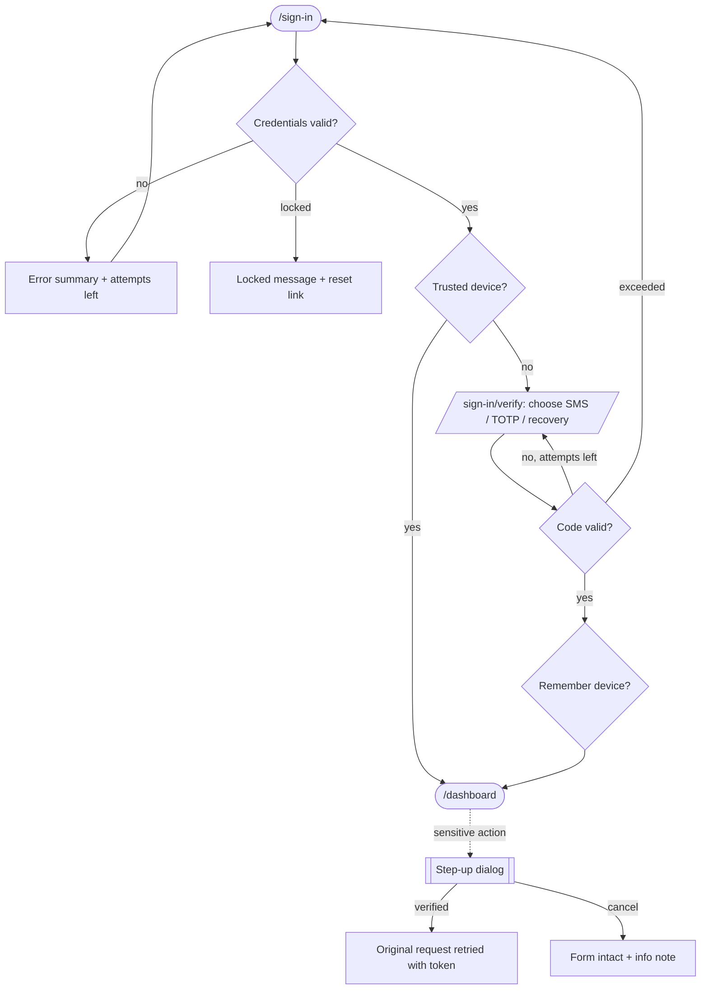
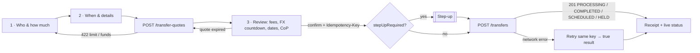
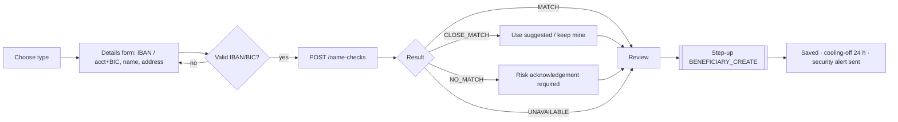
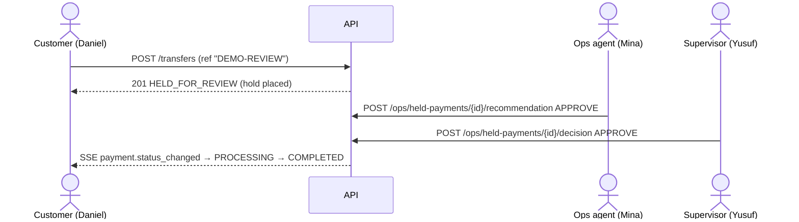

# User Flows and Demo Script

## 1. Sign-in with MFA and step-up (F01)

## 2. Transfer wizard (F04)

## 3. Add beneficiary (F04)

## 4. Held payment maker-checker (F11)

## 5. Demo script (≈ 15 minutes) — executed at Phase 7 gate
| # | Step | Persona | Proves |
|---|---|---|---|
| 1 | Open app → demo banner visible; switch to Arabic and back | — | Art. X, RTL |
| 2 | Sign in as Sara; OTP from Dev outbox; tick "Remember this device" | Sara | J2, AUTH-001/003/006 |
| 3 | Dashboard: totals per currency, hide balances toggle, upcoming rent | Sara | F02 |
| 4 | Open Everyday Current; search "lulu"; open a USD card purchase detail | Sara | F03 |
| 5 | Move AED 1,000.00 → USD account; watch 30 s quote countdown; confirm | Sara | J3, FX, ledger |
| 6 | Add domestic payee (CoP close match → accept suggestion) with step-up | Sara | XFER-012/014/015 |
| 7 | Pay Ahmad Saleh 1,200.00, reference "Nov rent top-up"; receipt live → Completed; download PDF | Sara | J4 |
| 8 | Pay Ahmad again with reference `DEMO-REJECT`; see Failed + balance restored + alert | Sara | XFER-034 |
| 9 | Cards: freeze debit card, toggle online purchases, show card details (step-up, 30 s) | Sara | J6 |
| 10 | Pay AquaGrid bill using inquiry amount | Sara | J7 |
| 11 | Download last month's statement; generate balance certificate in Arabic | Sara | J8, NFR-I18N-004 |
| 12 | Sign in as Layla (other browser); transfer leaves balance < 250 → low-balance alert toast | Layla | J9 |
| 13 | Daniel sends EUR to Carlos with `DEMO-REVIEW`; Mina recommends, Yusuf approves; Daniel sees live update | Daniel, Mina, Yusuf | J12 |
| 14 | Idle 4 min (or `/dev/clock` +240 s) → timeout modal → Stay signed in | Sara | AUTH-031 |
| 15 | Settings › Security: sessions list, sign out everywhere | Sara | J10 |
