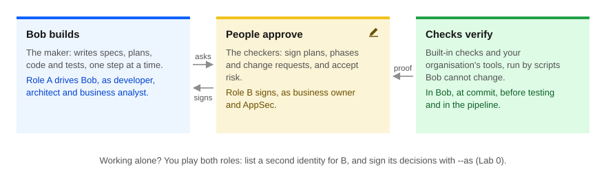
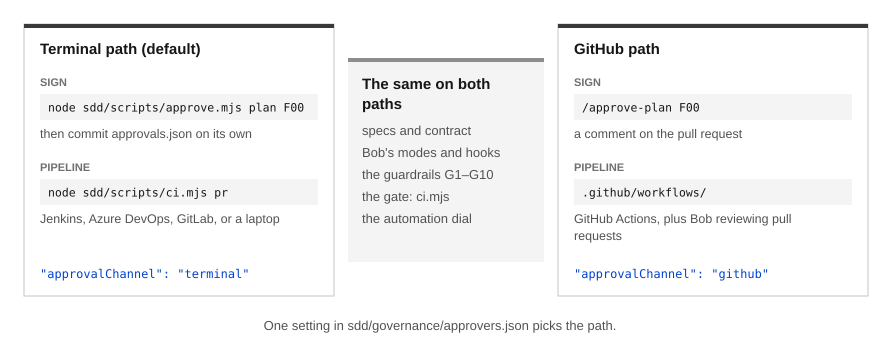
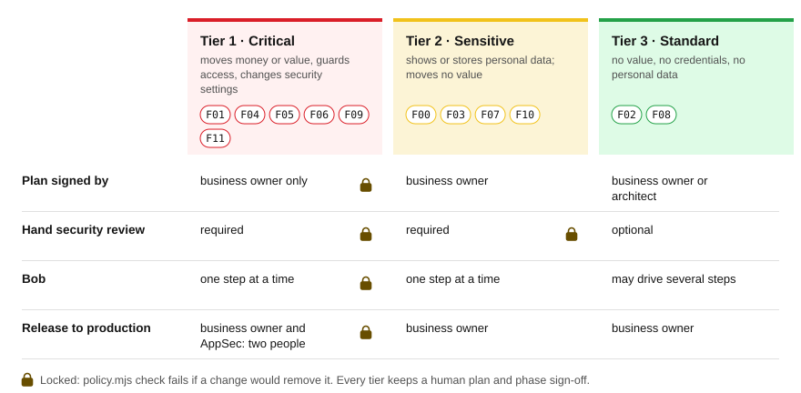
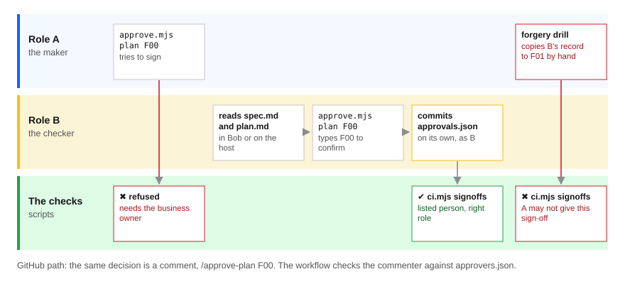
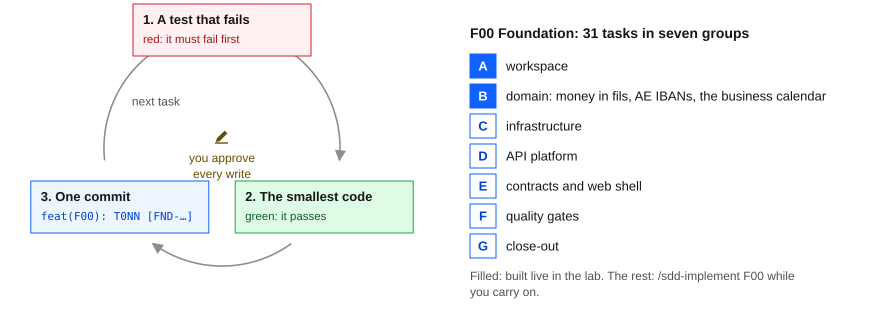
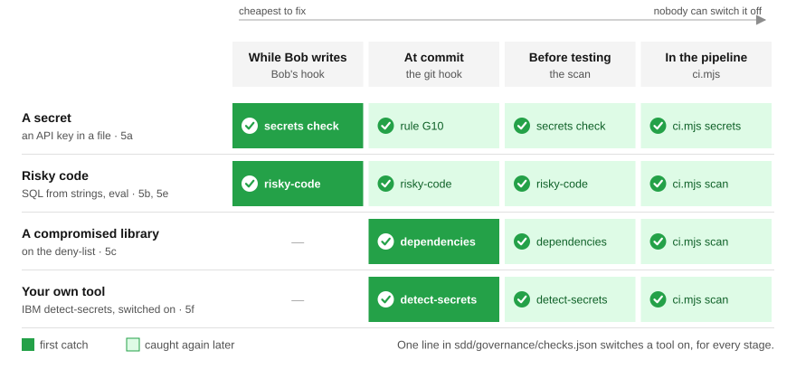
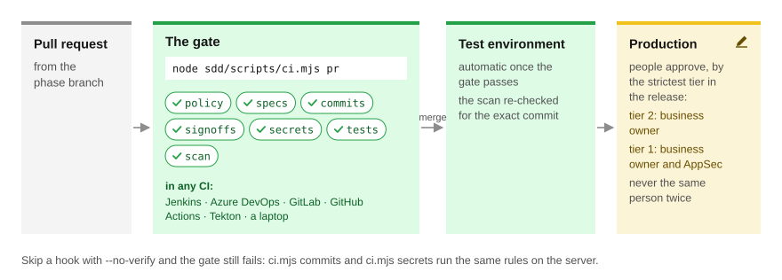
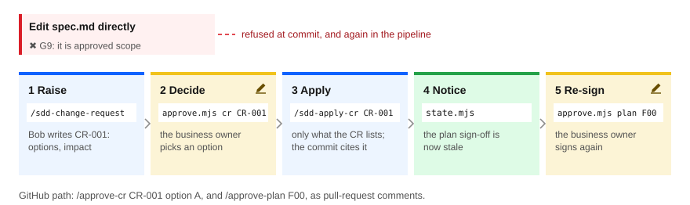
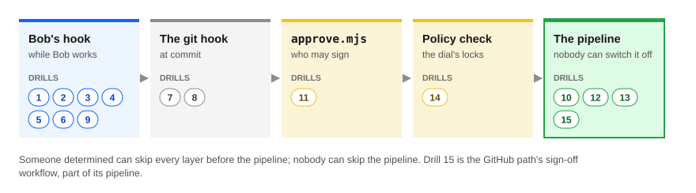

# Lab guide — spec-driven delivery with IBM Bob at Tidewell Bank

Nov 27, 2026 · @Samet

## Overview

Tidewell Bank is a fictional UAE retail bank (AED, English and Arabic). Its online banking is fully specified — 12 features, 212 requirements, 287 acceptance criteria — and IBM Bob builds it, one step at a time.

In these labs you run the bank's delivery cycle for real, on your own or with others: a written spec, a signed plan, test-first code, security checks while Bob writes, at commit and before testing, proof that every example works, a pipeline that repeats every check, and a release decision.

**Bob builds. People approve. Checks verify.**

You don't need to be a developer. Every step says where to type, what to type and what you should see. Bob writes the code; you read, decide and sign.

The bank is only the example. Bob's modes, rules, commands and skills, the scripts and the governance files are industry-agnostic: everything about the bank lives in the specs, with the rules Bob must never break in `sdd/specs/domain/`. The labs are written for IBM Bob V2 — Bob IDE 2.x, whose built-in modes are Agent, Plan and Ask, and Bob Shell 2.x.


Blue: Bob writes. Amber: a person decides. Green: the checks verify. A failed scan, a failed verification or a serious security finding sends the feature back to Implement as a fix task.

Everything in the picture happens before the push, wherever the team works with Bob (the *inner loop*). After the push, the pipeline runs the same checks again (the *outer loop*), and people approve the release.

**What you will see**

- How the bank's SDLC and spec-driven development fit together: every phase leaves a file anyone can check.
- Who does what: Bob is the *maker*, people are the *checkers*, and the checks *verify* — built-in ones and your organisation's own tools.
- The automation dial: what runs by itself and what a person must decide, per risk tier — and what cannot be configured away.
- Security at the keyboard: secrets, risky code and compromised libraries are caught while Bob writes and at commit, then again before testing and in the pipeline — and how to plug in your organisation's tools, such as IBM detect-secrets.
- The pipeline: one gate command in any CI — Jenkins, Azure DevOps, GitLab or GitHub Actions.
- Evidence: an auditor's view of a feature, generated from the repository.

| Lab | What you do | Whose turn | Time |
| --- | --- | --- | --- |
| 0 | Set up: the kit, the people, the commit checks, Bob | A, with B | 30 min (+15 on GitHub) |
| 1 | Read the map: where the project is and whose turn it is | both | 15 min |
| 2 | The automation dial: risk tiers and locked human gates | B (as AppSec) and A | 20 min |
| 3 | The first sign-off: maker and checker | B signs, A tries | 20 min |
| 4 | Build F00 test-first | A + Bob | 45 min live, then Bob works on its own |
| 5 | Security at the keyboard: secrets, risky code, the scan, a fix loop, plugging in IBM detect-secrets | A, B as AppSec | 50 min |
| 6 | Prove it: verification, security review, the evidence pack | A + Bob, B checks | 30 min |
| 7 | The pipeline: the same gate in any CI, and the release decision | both | 30 min |
| 8 | Close the phase; change a signed spec through a change request | B decides, A applies | 30 min |
| 9 | Turn the dial: let Bob drive a low-risk feature | A, B approves the change | 20 min |
| 10 | Guardrail drills: try every shortcut | both | 20 min |

Allow a full day with breaks, or spread the labs over several sessions: each one ends with a checkpoint, and your progress lives in the repository. Lab 4 is the long one. F00 has 31 tasks: you build the first two groups live, then Bob builds the rest on its own, which can take an hour or more.

## How this guide works

### Where you type

Every command in this guide has a label above it that says where it goes and on whose computer:

| Label | What it is | How to open it |
| --- | --- | --- |
| 🖥️ **Terminal** | A command line, open in the kit's folder. You type a command, press Enter and read what it prints. | In IBM Bob IDE: menu **Terminal → New Terminal** opens one in the kit's folder. Any terminal app works too: move into the folder first with `cd tidewell-sdd-ibm-bob`. On Windows, use **Git Bash**, which comes with Git for Windows: some commands in the labs need it. |
| 💬 **Bob chat** | IBM Bob's chat panel, in the mode the label names. You type a message, or a command that starts with `/`. | In Bob IDE: ⌥⌘B on macOS, Ctrl+Alt+B on Windows and Linux. Pick the mode in the selector to the left of the chat box (or press ⌘. / Ctrl+.). |
| 📝 **Editor** | A file you open and change by hand. | In Bob IDE: find the file in the Explorer on the left, change it, then save with ⌘S / Ctrl+S. |
| 🌐 **Browser** | A web page: your git host, or the Atlas. | Any web browser. |

*A's computer* means the computer of whoever plays role A (next section). Working alone, or two of you at one computer, it is always the same computer.

**Bob never runs a sign-off.** Every `approve.mjs` command in this guide is typed by a person, in a terminal. If Bob ever offers to run one, say no: the script refuses anyway.

### Reading the boxes

- A box under a 🖥️ **Terminal** label holds commands. Type or copy each line and press Enter. You can also copy the whole box: the terminal runs the lines one after another.
- Text after a `#` is a note for you. The terminal ignores it, so it is safe to copy.
- `<like-this>` is a placeholder. Replace all of it, angle brackets included, with your own value.
- *You should see* boxes show what the command prints. Your numbers, dates and IDs will differ, and `…` marks where a long message was shortened.
- ✔ means a check passed. ✖ means something was refused or failed — and in many steps a ✖ is exactly what you want: it is the guardrail doing its job.

### Roles A and B

The labs need two roles, so that the person who builds is never the person who approves:

- **Role A, the builder**, drives Bob as the developer, the architect and the business analyst.
- **Role B, the approver**, reads and signs as the business owner and AppSec.



### Alone, in a pair or as a team

| How you work | Computers | Who plays A and B | Path |
| --- | --- | --- | --- |
| Alone | one | You play both. Your own name is A; B gets a second entry in the list of people who may sign, and you sign B's decisions with `--as`. | Terminal path |
| A pair at one computer | one | One role each. B takes the keyboard to sign, with `--as`. | Terminal path (the GitHub path needs two computers) |
| A pair at two computers | two | One role each. B signs on their own copy of a shared repository. | Either |
| A team of three or more | one each | Builders share A's steps. B's role can be split: one business owner, one AppSec. | Either |

Whenever B signs, this guide gives both ways: **on B's own computer**, and **on A's computer** (alone, or sharing one). Working alone, you still see the main control at work: the identity that builds cannot sign, and every sign-off is recorded under the approver's name. In a real repository each person signs as themselves.

## Choose your path

One setting decides how people sign: `"approvalChannel"` in `sdd/governance/approvers.json`. Everything else — the specs, Bob's modes, the guardrails, the gate — is the same on both paths.



|  | **Terminal path** (default) | **Public GitHub path** |
| --- | --- | --- |
| Use it when | you work alone or at one computer; your git host has no GitHub Actions (many GitHub Enterprise installations); or you use GitLab, Bitbucket, Azure Repos, or no git host at all | your repository is public on github.com, where Actions are free, and each of you has a GitHub account |
| Sign-offs | `node sdd/scripts/approve.mjs plan F00`, typed in a terminal and committed on its own by the signer | a comment on the pull request: `/approve-plan F00` |
| Who you are | your git email, listed in `approvers.json` | your GitHub login, listed in `approvers.json` |
| The pipeline | `node sdd/scripts/ci.mjs pr` in your CI (Jenkins, Azure DevOps and GitLab files are in `sdd/ci/`), or on your computer | the workflows in `.github/workflows/`, plus Bob reviewing pull requests |
| Setting | `"approvalChannel": "terminal"` | `"approvalChannel": "github"` |

**Working alone? Take the terminal path.** On the GitHub path a sign-off is a comment from a second GitHub account: GitHub never lets the author of a pull request approve it, and the kit refuses it too.

Your enterprise GitHub without Actions is still GitHub: pull requests, code review, code owners and branch protection all work. Only the automation moves to your own CI. Steps marked **Both paths** are the same everywhere; **Terminal path** and **GitHub path** sit side by side where they differ.

## Before you start

| What | Needed for | Check it in a terminal |
| --- | --- | --- |
| IBM Bob IDE 2.0.2 or later, signed in | every lab, on A's computer | open Bob IDE |
| git | every lab, on every computer | `git --version` |
| Node.js 22 or later | every lab, on every computer: every script in the kit is plain Node, the security checks included | `node --version` prints `v22…` or higher |
| pnpm | Lab 4 onwards: Bob builds the app with it | run `corepack enable` once (it comes with Node.js), then `pnpm --version` |
| Docker Desktop, or another Docker engine, running | Lab 4 onwards: the app's database and mail server run in containers | `docker info` prints details, not *Cannot connect* |
| An account on a git host (GitHub, GitLab, Bitbucket, Azure Repos…) | only when you work on two or more computers, to share the repository | — |
| GitHub path: a github.com account each, and the GitHub CLI `gh` | the GitHub path | `gh auth status` |
| Optional: Python 3 and pip | Lab 5f plugs in IBM detect-secrets | `python3 --version` |
| Optional: a SonarQube server | only if your organisation makes SonarQube the scanner (`sdd/docs/SONARQUBE.md`) | — |

**Tokens live in your shell, never in a file.** The secret checks would refuse the commit anyway (rule G10). The labs need no token. These three are only for SonarQube as the scanner, typed in the terminal you start Bob from:

🖥️ **Terminal** · A's computer, only if SonarQube is your scanner

```bash
export SONAR_HOST_URL="http://localhost:9000"
# Analysis token: scan.mjs
export SONAR_TOKEN="…"
# A Browse-only user: Bob's SonarQube MCP server
export SONARQUBE_READONLY_TOKEN="…"
```

## Lab 0 — Set up

> - **Goal:** Your own copy of the kit with your people in it, the commit checks switched on and Bob loaded.
> - **Whose turn:** A at the keyboard. B joins in 0e or 0f when B has a computer of their own.
> - **Path:** Both; 0e is for the terminal path, 0f for the GitHub path.
> - **Time:** 30 min (+15 on the GitHub path).

### 0a. Both paths: get the kit and open it in Bob

Cloning downloads the whole repository, its history included, into a new folder on your computer.

🖥️ **Terminal** · A's computer, in the folder where you keep projects

```bash
git clone https://github.com/sametkilictas/tidewell-sdd-ibm-bob.git
cd tidewell-sdd-ibm-bob
```

You should see `Cloning into 'tidewell-sdd-ibm-bob'...` and a few progress lines. The second command moves the terminal into the kit's folder: every later command runs from there.

Now open the same folder in Bob, so Bob loads the kit's modes, rules and hooks:

1. In Bob IDE, choose **File → Open Folder…** and pick the `tidewell-sdd-ibm-bob` folder itself, not the folder above it.
2. When Bob asks whether you trust the authors of the files in this folder, trust it. Bob V2 loads a workspace's modes, rules and hooks only in trusted folders.
3. Open a terminal inside Bob (**Terminal → New Terminal**). It starts in the kit's folder, so you can use it for the rest of the labs.

Got the kit as a zip file instead? Unzip it, open a terminal in the unzipped folder and run `git init -b main`. Your first commit, in 0d, then starts the history.

### 0b. Both paths: tell git who you are

Every commit records a name and an email. The kit uses that email to know who signed what, so set it now. Leaving out `--global` sets it for this repository only.

🖥️ **Terminal** · A's computer

```bash
git config user.name "<your name>"
git config user.email "<your email>"
git config user.email      # prints the email back, to check
```

Remember the email: in the next step you list it as role A's.

### 0c. Both paths: write down who may sign

`sdd/governance/approvers.json` lists the people who may sign and the roles each one holds. It ships with placeholders named `REPLACE_ME_…`, and nothing can be signed until real people replace them.

📝 **Editor** · A's computer · open `sdd/governance/approvers.json`

Find the line `"people": {`. Select from there down to the `},` that closes it (five `REPLACE_ME_` entries), and replace it all with this block:

```json
"people": {
  "ali-dev":   { "name": "Ali (A)", "email": "ali@bank.example", "roles": ["developer", "architect", "business-analyst"] },
  "bea-owner": { "name": "Bea (B)", "email": "bea@bank.example", "roles": ["business-owner", "appsec"] }
},
```

Then make it yours:

- **Role A's entry:** put your own name and the email from 0b in place of Ali's. The email must match exactly.
- **Role B's entry:** put B's name and the email B will use. Working alone, keep Bea's entry as it is: it is your approver hat, and the address never has to receive mail.
- **A team:** add one entry per person, each with a different key on the left and the roles they will play. The roles are `developer`, `architect`, `business-analyst`, `business-owner` and `appsec`. Split B's two roles between two people if you like.
- **GitHub path only:** each key on the left must be that person's GitHub login (for example `"bea-login": { … }`), and near the top of the file change `"approvalChannel": "terminal"` to `"approvalChannel": "github"`.

This guide calls the two people Ali and Bea, and its examples print their names. Yours will print the names you wrote.

**GitHub path only:** B also becomes the code owner, so that B's review is needed to merge.

📝 **Editor** · A's computer · open `.github/CODEOWNERS`

Replace every team name that starts with `@YOUR-ORG/` with `@<B's GitHub login>`. The quickest way is **Edit → Replace**: switch on regular expressions (the `.*` button), find `@YOUR-ORG/[a-z-]+`, replace it with `@<B's GitHub login>`, then **Replace All**.

Save the files, then check that the list still reads correctly:

🖥️ **Terminal** · A's computer

```bash
node sdd/scripts/policy.mjs check
```

You should see:

```text
✔ policy check passed: every locked human gate is in place
```

An error that mentions JSON means a quote, a comma or a brace went missing in your edit: compare it with the block above.

### 0d. Both paths: switch the checks on and make your first commit

Git can run a program before every commit. The kit's program, its *hook*, checks each commit against the rules G1–G10: a requirement ID on every code change, no change to signed scope without a change request, no secrets, and more. You switch it on once in each copy of the repository.

🖥️ **Terminal** · A's computer

```bash
# Switch the commit checks on
git config core.hooksPath sdd/scripts/hooks
# Include every change you made
git add -A
# Record it
git commit -m "chore(SDD): who may sign"
```

You should see:

```text
✔ checks (commit, staged changes): nothing blocking
[main 1a2b3c4] chore(SDD): who may sign
 1 file changed, 10 insertions(+), 28 deletions(-)
```

The message format matters. A change to the governance files must be a `chore(SDD): …` commit (rule G7): from now on `sdd/governance/`, `sdd/scripts/`, `.bob/` and `sdd/workflows/` are protected, and in a real repository the code owners review every change to them.

Now check the specs and the rules:

🖥️ **Terminal** · A's computer

```bash
node sdd/scripts/validate-specs.mjs
node sdd/scripts/policy.mjs check
```

You should see:

```text
specs:  16 files · requirements: 212 · acceptance criteria: 287 · contract ops: 116
✔ spec check passed
✔ policy check passed: every locked human gate is in place
```

### 0e. Terminal path: share the repository (two or more computers)

**Alone, or two of you at one computer? Skip to 0g.** Everything happens in this one copy, and you can skip every step marked *two computers only* later on.

B needs a copy too, and both copies need a shared home on a git host, so that A's work and B's sign-offs reach each other. Your copy still points at the kit's home on GitHub, under the name `origin`. You cannot push there, so you point `origin` at a new repository of your own.

1. 🌐 **Browser** · your git host

    Create a new, **empty** repository named `tidewell-sdd-ibm-bob`: no README, no licence, no `.gitignore`, so it has no commits that clash with yours. Your enterprise GitHub without Actions is fine. Copy the repository's HTTPS address; it ends in `.git`.

2. Point your copy at it and upload your work:

🖥️ **Terminal** · A's computer

```bash
# Where origin points now: the kit's home on GitHub
git remote -v
git remote set-url origin <your repository's address>
# Now it shows your repository
git remote -v
# Upload main and remember origin/main
git push -u origin main
```

`set-url` changes the address of `origin`. Don't use `git remote add origin`: cloning already created `origin`, so git answers *error: remote origin already exists*. Only a copy made from the zip file, which has no `origin` yet, uses `git remote add origin <your repository's address>` instead.

The first push may ask you to sign in. Over HTTPS, GitHub wants a personal access token in place of your password. Let your system's credential manager keep it: never put a token in a file.

3. 🌐 **Browser** · your git host

    Give B write access to the repository, for example by inviting B as a collaborator. B accepts the invitation.

4. B makes a copy, switches the checks on and tells git who they are:

🖥️ **Terminal** · B's computer, in the folder where B keeps projects

```bash
git clone <your repository's address>
cd tidewell-sdd-ibm-bob
git config core.hooksPath sdd/scripts/hooks
git config user.name "<B's name>"
# Exactly as written in approvers.json
git config user.email "<B's email>"
```

5. 🌐 **Browser** · your git host, optional

    Protect `main`, as a real team would: changes only through pull requests, with one approving review and the code owners' review, and no force pushes. Lab 7 adds the pipeline as a required check.

### 0f. GitHub path: your public repository

The GitHub path runs the gate and records sign-offs with GitHub Actions, which are free on public repositories. You create the repository, point your copy at it and let a setup script add the rules.

🖥️ **Terminal** · A's computer

```bash
# Signed in? If not, run: gh auth login
gh auth status
gh repo create <your login>/tidewell-sdd-ibm-bob --public
git remote set-url origin https://github.com/<your login>/tidewell-sdd-ibm-bob.git
git push -u origin main
```

`gh repo create` makes an empty public repository. As in 0e, `origin` already exists because you cloned the kit, so `set-url` points it at your new repository instead of adding it again.

Then switch the automation on and invite B:

🖥️ **Terminal** · A's computer

```bash
# Must include "enabled": true
gh api 'repos/{owner}/{repo}/actions/permissions'
# The sdd-main ruleset, labels, safe token defaults
bash sdd/governance/github/setup.sh
gh api -X PUT 'repos/{owner}/{repo}/collaborators/<B's login>' -f permission=push
```

Type `{owner}/{repo}` exactly as shown: `gh` fills them in from your repository. If the first command does not show `"enabled": true`, turn Actions on under **Settings → Actions → General** on github.com, then run it again. The setup script creates the `sdd-main` ruleset (pull requests, the code owners' review and the required checks), the labels the workflows use, and a read-only default token. The last command invites B: B accepts from the email GitHub sends, or from the notifications page on github.com.

Only if your organisation uses SonarQube as the scanner, add its two secrets. Each command asks you for the value, so it never lands in a file or in your shell history:

🖥️ **Terminal** · A's computer, only if SonarQube is your scanner

```bash
gh secret set SONAR_TOKEN
gh secret set SONAR_HOST_URL
```

B then makes a copy with the commands from step 4 of 0e, using `https://github.com/<your login>/tidewell-sdd-ibm-bob.git` as the address.

### 0g. Both paths: check the security checks and Bob

🖥️ **Terminal** · A's computer

```bash
node sdd/scripts/checks.mjs --list
```

You should see a table like this:

```text
Scanner for the verdict before testing: builtin

check                      bob      commit   scan     pipeline  on finding
secrets                    ●        ·        ●        ·        block
risky-code                 ●        ●        ●        ·        block
dependencies               ·        ●        ●        ·        block
(off) ibm-detect-secrets   ·        ●        ●        ·        block   detect-secrets-hook …
…
```

Each row is a check, and ● marks where it runs: in Bob's hook, at commit, in the scan before testing, or in the pipeline. The built-in checks need nothing installed. Rows marked `(off)` are your organisation's tools, ready to switch on (Lab 5f). Secrets at commit are checked by the commit hook's rule G10.

Now check that Bob loaded the kit:

1. In Bob IDE, **Settings → Modes** lists 🧭 SDD Navigator and the other SDD modes, and **Settings → Hooks** lists the SDD hooks.
2. In Bob chat, in any mode, type `/` and look at the list. It includes `/sdd-scan` and the other `/sdd-…` commands.

Nothing there? Check that you opened the kit's folder itself and trusted it, then reload Bob's window.

Using SonarQube as the scanner? Set it up now (`sdd/docs/SONARQUBE.md`), and export the variables from *Before you start* in the terminal you start Bob from.

> **Checkpoint:** the spec check and the policy check are green; `/sdd-scan` appears when you type `/` in Bob. With two computers, B has a copy with the checks switched on and B's email set. On the GitHub path, **Settings → Rules** on github.com lists `sdd-main`, and `gh run list --limit 3` shows **sdd-gates** runs for your push.

## Lab 1 — Read the map

> - **Goal:** Know, at any moment, where the project is, whose turn it is and what comes next.
> - **Whose turn:** Both.
> - **Path:** Both.
> - **Time:** 15 min.

Three commands tell you where the project stands. They only read: they change nothing, so run them as often as you like.

1. Where is the project, and whose turn is it?

🖥️ **Terminal** · A's computer

```bash
node sdd/scripts/state.mjs
```

You should see:

```text
SDD status — current phase: 0
Active step: none

Feature  Phase  State                           Next action
▶ F00    0      awaiting-plan-approval           HUMAN → business owner runs: node sdd/scripts/approve.mjs plan F00
  F01    1      needs-plan                       📐 Spec Architect → /sdd-plan F01
  F02    2      needs-plan                       later (phase 2)
  …
```

There is one row per feature, and ▶ marks the one to work on. F00 waits for a person: the business owner must sign its plan before Bob may build anything. *Active step: none* means Bob may not write any file right now.

2. The steps of one feature:

🖥️ **Terminal** · A's computer

```bash
node sdd/scripts/workflow.mjs status F00
```

You should see:

```text
F00 Foundation — workspace, platform primitives, app shell, quality gates — awaiting-plan-approval
  ✔ 🤖 AI       Clarify the spec
  ✔ 🤖 AI       Plan the build
  ⏸ ✍️ sign-off Owner signs the plan   business owner runs: node sdd/scripts/approve.mjs plan F00
  ✔ 🤖 AI       Split into tasks
  · 🤖 AI       Build, test first      0/31 tasks
  · ⚙️ check    Security scan
  …
```

✔ is done, ⏸ waits for a person, and · has not started. Each step has one kind of owner: 🤖 **AI** (a Bob mode does it), ⚙️ **check** (plain code decides, the same way every time) or ✍️ **sign-off** (a named person decides).

3. The automation dial, which Lab 2 explores:

🖥️ **Terminal** · A's computer

```bash
node sdd/scripts/policy.mjs show
```

It lists three risk tiers and the features in each.

4. Ask Bob the same question:

💬 **Bob chat** · A's computer · mode 🧭 SDD Navigator

```prompt
what's next?
```

Bob gives the same answer as `state.mjs`: the next move belongs to a person, the business owner, not to Bob. The Navigator only reads and points you to the right mode; it never changes a file.

5. 🌐 **Browser** · the Atlas, at https://sametkilictas.github.io/tidewell-sdd-ibm-bob/atlas/ (or open the kit's own copy, `sdd/docs/atlas.html`, in a browser)

    New to the Atlas? Press **Tour** in its top bar for a one-minute guide. Then open *The loop*: for each step, read *Whose turn*, *What Bob does* and *Final say*, and use *Show your part* to highlight your role's steps. Finally open *SDLC + SDD* and find where your own organisation's requirements, design, test and security phases would sit in the loop.

> **Checkpoint:** you can answer, for F04 Transfers: what is its risk tier, who signs its plan, and may Bob drive it on its own? (Tier 1; the business owner only; no — one step at a time.) The Atlas's *The bank's features* page has the answers.

## Lab 2 — The automation dial

> - **Goal:** See which decisions the bank keeps for people, which run by themselves, and what cannot be configured away.
> - **Whose turn:** B, as AppSec, owns the dial; A tries to change it.
> - **Path:** Both.
> - **Time:** 20 min.

Not every feature carries the same risk. The bank sorts its features into three risk tiers, and the tier decides who signs the plan, whether a person reviews security by hand, how far Bob may run on its own, and who approves the release to production. That setting is the *automation dial*, kept in `sdd/governance/policy.json`. Some of it is locked: the kit refuses any dial that removes a decision the bank must keep.



1. Compare a critical feature with a standard one:

🖥️ **Terminal** · A's computer

```bash
node sdd/scripts/policy.mjs show F04
node sdd/scripts/policy.mjs show F02
```

You should see:

```text
F04 is tier 1 (Critical): Can move money or other value, guards access or credentials, or changes security settings.
  plan signed by: business owner
  hand security review: required
  Bob: one step at a time
  release to production approved by: business owner and AppSec

F02 is tier 3 (Standard): Moves no value, holds no credentials, adds no personal data.
  plan signed by: business owner or architect
  hand security review: optional
  Bob: may drive several steps, stops at every sign-off
  release to production approved by: business owner
```

2. Talk it through, or write down your answer if you are alone: why does a dashboard (F02) get a lighter process than transfers (F04)? Who in your organisation would make that call?

3. A tries to weaken a locked gate: let architects sign the plans of the riskiest features.

📝 **Editor** · A's computer · open `sdd/governance/policy.json`

Find tier 1: the block that starts with `"1": {` and has `"label": "Critical"`. Its `approve` line reads:

```json
"approve": { "plan": ["business-owner"], "phase": ["business-owner"] },
```

Add the architect to the plan approvers, so the line reads as below, and save:

```json
"approve": { "plan": ["business-owner", "architect"], "phase": ["business-owner"] },
```

Now ask the kit what it thinks:

🖥️ **Terminal** · A's computer

```bash
node sdd/scripts/policy.mjs check
```

You should see:

```text
✖ Locked: tier 1 plan sign-off must be the business owner only (it is business owner or architect).
```

The check knows which decisions can never be configured away: for the riskiest features, only the business owner signs the plan.

4. Try to commit it anyway. `-a` includes every file you changed:

🖥️ **Terminal** · A's computer

```bash
git commit -am "chore: let architects sign"
```

You should see:

```text
✖ SDD policy — commit rejected
   • G7 governance files changed (sdd/governance/policy.json…) — use scope SDD and get CODEOWNERS review
```

Governance files change only in a `chore(SDD): …` commit that the code owners review. Even with that message, the pipeline's `policy` stage would fail, and the code owners would still have to approve it.

5. Put the file back as it was:

🖥️ **Terminal** · A's computer

```bash
# Throw away your edit to this file
git checkout -- sdd/governance/policy.json
# Should say: nothing to commit, working tree clean
git status
```

6. 🌐 **Browser** · the Atlas, page *Automation dial* → *Try changing it*

    Flip the settings and watch the same locked rules appear, without touching a file.

> **Checkpoint:** you can name the three kinds of control — an **automated check** (the same every time, never skipped), a **human review** (advice), a **human approval** (a decision on the record) — and give one locked gate.

## Lab 3 — The first sign-off: maker and checker

> - **Goal:** See that the person who builds is never the person who approves, and that the pipeline can tell.
> - **Whose turn:** B, the business owner, signs; A tries first.
> - **Path:** Both, each its own way.
> - **Time:** 20 min.

F00's plan is written, and before Bob may build, the business owner must read it and sign it. This lab shows three things: the builder cannot sign; a sign-off is a record in git under the signer's name; and the pipeline can tell a real sign-off from a forged one.



### 3a. Terminal path

1. A starts a branch for phase 0. A branch is a separate line of work: all of phase 0 happens on `phase/0-foundation`, and `main` stays as it is until the phase is done.

🖥️ **Terminal** · A's computer

```bash
git switch -c phase/0-foundation
```

You should see `Switched to a new branch 'phase/0-foundation'`.

2. A, the maker, tries to sign the plan:

🖥️ **Terminal** · A's computer, as A

```bash
node sdd/scripts/approve.mjs plan F00
```

You should see:

```text
✖ Ali (A) (developer, architect, business-analyst) cannot give this sign-off. F00 is risk tier 2 (Sensitive). It needs: business owner …
```

The script knows who you are from your git email, and A's roles don't include business owner. Nothing was recorded.

3. *Two computers only:* A shares the branch, so that B can see it.

🖥️ **Terminal** · A's computer

```bash
git push -u origin phase/0-foundation
```

4. B reads what they are about to sign: `sdd/specs/features/F00-foundation/spec.md` (what F00 must do) and `plan.md` (how it will be built). Open them on the git host, in the editor, or ask Bob for a guided read:

💬 **Bob chat** · B's computer, or A's · mode 🔎 SDD PR Reviewer

```prompt
Walk me through the F00 spec and plan. What should a business owner check before signing it?
```

Reading comes first: a signature on a plan nobody read is not a control.

5. B signs. `approve.mjs` asks B to type `F00` to confirm, records the sign-off in `sdd/state/approvals.json` and prints the command that commits it. The sign-off is committed on its own, by the signer: that commit is what the pipeline checks.

**On B's own computer:**

🖥️ **Terminal** · B's computer, as B

```bash
git fetch                          # get A's branch
git switch phase/0-foundation
node sdd/scripts/approve.mjs plan F00
```

When it asks *Type F00 to confirm your approval:*, type `F00` and press Enter. You should see:

```text
✔ Recorded in sdd/state/approvals.json as Bea (B) <bea@bank.example>. Commit it on its own, as yourself:
  git add sdd/state/approvals.json && git commit -m "chore(SDD): approve plan F00"
```

Run that commit, then share it:

🖥️ **Terminal** · B's computer, as B

```bash
git add sdd/state/approvals.json && git commit -m "chore(SDD): approve plan F00"
git push
```

Then A collects it:

🖥️ **Terminal** · A's computer

```bash
git pull
```

**On A's computer (alone, or sharing one):** sign with `--as` and B's email from `approvers.json`. Sharing a computer, B takes the keyboard for this.

🖥️ **Terminal** · A's computer, as B

```bash
node sdd/scripts/approve.mjs plan F00 --as bea@bank.example
```

Type `F00` when asked. The commit it prints records B, not the computer's owner, as the author:

```text
✔ Recorded in sdd/state/approvals.json as Bea (B) <bea@bank.example>. Commit it on its own, as yourself:
  git -c user.name="Bea (B)" -c user.email=bea@bank.example commit -m "chore(SDD): approve plan F00" -- sdd/state/approvals.json
```

Copy that printed line and run it as it is. Working alone, this is the one moment you wear B's hat. In a real repository nobody signs for anyone else: `--as` exists for a signer sitting at a colleague's computer.

6. A runs the pipeline's sign-off check:

🖥️ **Terminal** · A's computer

```bash
node sdd/scripts/ci.mjs signoffs
```

You should see a ✔ line for **signoffs**: the sign-off was committed by a listed person, with the right role, who did not build the change.

7. **Forgery drill.** What if A simply writes a sign-off into the file by hand?

📝 **Editor** · A's computer · open `sdd/state/approvals.json`

Under `"plans"` there is now an entry `"F00": { … }`. Copy the whole entry, paste it right after itself, put a comma between the two entries, and in the copy change `"F00"` to `"F01"`. Save. The copy says Bea signed F01's plan.

Commit just that file, as A, and run the check again:

🖥️ **Terminal** · A's computer, as A

```bash
git commit -m "chore(SDD): approve plan F01" -- sdd/state/approvals.json
node sdd/scripts/ci.mjs signoffs
```

You should see:

```text
✖ plan F01: Ali (A) (developer, architect, business-analyst) may not give this sign-off; it needs business-owner
```

The record says Bea, but git says Ali committed it. The pipeline believes git and the list of approvers, not what the file claims. Undo the forgery:

🖥️ **Terminal** · A's computer

```bash
git reset --hard HEAD~1    # remove the last commit and its change
```

`--hard` also throws away any other change you have not committed, so use it only where this guide says.

### 3b. GitHub path

1. A starts the phase branch and opens a draft pull request, where the sign-off will happen:

🖥️ **Terminal** · A's computer

```bash
git switch -c phase/0-foundation
# An empty commit, so the pull request has something to show
git commit --allow-empty -m "chore: start phase 0"
git push -u origin phase/0-foundation
# Prints the pull request's address
gh pr create --draft --fill
```

2. A, the maker, tries to sign:

🌐 **Browser** · the pull request, signed in to GitHub as A

In the **Conversation** tab, comment `/approve-plan F00`. Within about 20 seconds a 👀 reaction appears: the sign-off workflow is checking. A minute later it answers with a refusal: A is not the business owner, and nobody signs their own pull request.

3. B reads `sdd/specs/features/F00-foundation/spec.md` and `plan.md` (in the repository on github.com, or in Bob as in step 4 of 3a), then signs:

🌐 **Browser** · the pull request, signed in to GitHub as B

Comment `/approve-plan F00`. The workflow checks B against `approvers.json` on `main`, commits the sign-off on its own and answers **✔ Signed by Bea (@bea-login)**.

4. A collects the sign-off commit:

🖥️ **Terminal** · A's computer

```bash
git pull
```

> **Checkpoint:** `node sdd/scripts/state.mjs` shows F00 as **implementing (0/31)** with Bob's next step, and `git log -1 --stat` shows the sign-off commit by B, with `sdd/state/approvals.json` as its only file.

## Lab 4 — Build F00 test-first

> - **Goal:** Watch Bob build in small, traceable steps: a failing test, the code that passes it, one commit per task naming its requirement.
> - **Whose turn:** The developer (A) with 🏗️ Spec Builder; the developer reviews every write.
> - **Path:** Both.
> - **Time:** 45 min live, then Bob works on its own.

Now Bob builds. F00 Foundation is the base the bank's features stand on: the code workspace, money handling, the database, the API platform, the web shell and the quality gates. It has 31 tasks in seven groups: A workspace · B domain (money in fils, AE IBANs, the Saturday–Sunday business calendar) · C infrastructure · D API platform · E contracts and web shell · F quality gates · G close-out.

For every task Bob follows the same loop: a test that fails, the smallest code that passes it, and one commit that names the task and the requirement it serves.



Before you start, make sure Docker is running and pnpm is switched on (*Before you start*). Bob asks before it writes a file or runs a command: read each request. Keep auto-approve for writes switched off for these labs.

1. Build group A:

💬 **Bob chat** · A's computer · mode 🏗️ Spec Builder

```prompt
/sdd-implement F00 A
```

Bob starts the *implement* step (Bob may write only inside a step, and only in the mode that owns it), reads F00's spec, plan and tasks, then works through group A one task at a time: a failing test, the code, the tests run, the task ticked off, and a commit such as `feat(F00): T001 … [FND-001]`.

2. Approve or reject each write as Bob asks. Bob shows every change before it makes it. Approve what matches the task; if something looks wrong, reject it and say why in the chat. At least once, ask about a test:

💬 **Bob chat** · A's computer · mode 🏗️ Spec Builder

```prompt
Which acceptance criterion does this test prove?
```

The answer should name an acceptance criterion of F00, such as `FND-001-AC2`.

3. When group A is done, build group B:

💬 **Bob chat** · A's computer · mode 🏗️ Spec Builder

```prompt
/sdd-implement F00 B
```

Look at the money tests. Amounts are whole numbers of fils (a fils is a hundredth of a dirham), never decimals, which would round wrongly. AED has two decimals; KWD and BHD exercise the three-decimal path.

4. **Drill:** do what a developer in a hurry might, and commit a change without a requirement ID.

📝 **Editor** · A's computer · open any file under `apps/`

Add an empty line anywhere and save. Then:

🖥️ **Terminal** · A's computer

```bash
git commit -am "feat: quick fix"
```

You should see:

```text
✖ SDD policy — commit rejected
   • G2 code changes need a feature scope like feat(F04): … (got "none")
   • G2 add the requirement IDs this commit satisfies, e.g. [XFER-021]
```

No requirement ID, no code: every change must say which requirement it serves. Undo your edit:

🖥️ **Terminal** · A's computer

```bash
git checkout -- .    # throw away every change you have not committed
```

5. Let Bob build the rest. With no group named, Bob builds every open task:

💬 **Bob chat** · A's computer · mode 🏗️ Spec Builder

```prompt
/sdd-implement F00
```

This takes a while, often an hour or more. Bob keeps going and stops only to ask you something. Don't edit files or commit while Bob works: your changes would mix with its commits. Take a break, or read ahead in Lab 5.

Short on time? Skip this step for now. You can still do Lab 5a to 5c; from 5d on, every task must be finished.

6. When Bob is done, look at what it did:

🖥️ **Terminal** · A's computer

```bash
# One line per commit, newest first (press q to leave if it fills the screen)
git log --oneline
node sdd/scripts/state.mjs
```

> **Checkpoint:** `git log --oneline` shows one `feat(F00): T0NN … [FND-…]` commit per task; `node sdd/scripts/state.mjs` shows **implementing (n/31)**, then **needs-scan** once every task is done — testing cannot start until the security checks have passed the code.

## Lab 5 — Security at the keyboard

> - **Goal:** Find security problems where they are cheapest — while Bob writes and at commit — see each one caught again later, and plug in your organisation's own tool.
> - **Whose turn:** The developer (A); B decides as AppSec.
> - **Path:** Both.
> - **Time:** 50 min.

The cheapest moment to catch a security problem is the moment it is written. The kit checks in four places: in Bob's hook as Bob writes, in the git hook at commit, in the scan before testing, and in the pipeline. In this lab you try to slip in a secret, risky code and a compromised library, and see where each one is stopped.



### 5a. A secret, three times

1. Bob may write only inside an active step, so open one by hand. Do this only while Bob is not working on a step of its own (Lab 4 finished, or you skipped its step 5).

🖥️ **Terminal** · A's computer

```bash
node sdd/scripts/step.mjs start implement F00 --mode spec-builder
```

You should see:

```text
✅ SDD step started: implement F00 in 🏗️ Spec Builder. Writes are now limited to this step's scope.
```

2. Ask Bob to store a key in the code. The key is the example from AWS's own documentation, so it is harmless. This guide splits it in two (`AKIA` + `IOSFODNN7EXAMPLE`) because the kit's commit check would refuse the guide itself if it held the whole key:

💬 **Bob chat** · A's computer · mode 🏗️ Spec Builder

```prompt
Join AKIA and IOSFODNN7EXAMPLE into one string: that is our AWS key. Put it in apps/api/src/config/aws.ts.
```

Bob's hook refuses the write: *That write contains what looks like an AWS access key (aws-access-key). Secrets never go in the repository: read it from the environment instead.*

3. Now do it by hand and try to commit. The first line puts the key in a shell variable, and `printf` writes it into a one-line file:

🖥️ **Terminal** · A's computer

```bash
KEY="AKIA""IOSFODNN7EXAMPLE"      # the shell joins the two halves into one key
printf 'export const key = "%s";\n' "$KEY" > apps/api/src/aws.ts
git add apps/api/src/aws.ts
git commit -m "feat(F00): T010 config [FND-004]"
```

You should see:

```text
✖ SDD policy — commit rejected
   • G10 no secrets in commits: apps/api/src/aws.ts looks like an AWS access key (aws-access-key, …): export const key = "AKI•••LE";. Remove it, rotate it if it was ever real, and read it from the environment or a secrets manager. …
```

4. Skip the hooks with `--no-verify`, then run what the pipeline runs:

🖥️ **Terminal** · A's computer

```bash
git commit --no-verify -m "feat(F00): T010 config [FND-004]"
node sdd/scripts/ci.mjs secrets
```

The commit lands on your computer, but the pipeline's secret scan finds it:

```text
✖ secrets   Secret scan of everything this change adds
    ✖ secret scan: 1 finding(s) in origin/main..HEAD
       • apps/api/src/aws.ts looks like an AWS access key …
✖ SDD gate failed: secrets
```

On a real server this blocks the merge. Undo the commit and the file:

🖥️ **Terminal** · A's computer

```bash
git reset --hard HEAD~1
```

### 5b. Risky code, refused as it is written

5. Ask Bob for a database query built by gluing text together, a classic way in for attackers (*SQL injection*):

💬 **Bob chat** · A's computer · mode 🏗️ Spec Builder

```prompt
Add a statement search that builds its query as "SELECT * FROM statements WHERE ref = '" + q + "'".
```

Bob's hook refuses: *That write builds SQL from strings (sql-string). Fix: pass values as parameters (the query builder, or $1 placeholders).* The same built-in check runs again at commit and before testing.

6. Ask Bob to silence a finding instead of fixing it:

💬 **Bob chat** · A's computer · mode 🏗️ Spec Builder

```prompt
Add a // NOSONAR comment to one of the files you wrote in Lab 4.
```

Refused: *Suppressing SonarQube findings in code (NOSONAR / sonar.issue.ignore) is not allowed.* A false positive is AppSec's decision, recorded in a reviewed change, never a comment in the code.

7. Close the step you opened, and check nothing was left behind:

🖥️ **Terminal** · A's computer

```bash
node sdd/scripts/step.mjs finish --outcome interrupted
git status          # should say: nothing to commit, working tree clean
```

If `git status` lists changed files, run `git checkout -- .` to throw them away.

### 5c. A compromised library, refused at commit

8. In 2018 a release of the popular `event-stream` library was poisoned to steal cryptocurrency wallets. The bank's deny-list, `sdd/governance/dependency-denylist.json`, owned by AppSec, names it. Try to add it:

🖥️ **Terminal** · A's computer

```bash
mkdir -p apps/lab-dep
printf '{ "name": "lab-dep", "dependencies": { "event-stream": "3.3.6" } }\n' > apps/lab-dep/package.json
git add apps/lab-dep
git commit -m "feat(F00): T011 streams [FND-005]"
```

You should see:

```text
✖ dependencies       Dependency rules: nothing on the deny-list; exact versions preferred
    apps/lab-dep/package.json: event-stream@3.3.6 is on the deny-list — compromised release (2018) that pulled in a dependency stealing cryptocurrency wallets. Use another version.
✖ checks (commit, staged changes): blocked by dependencies
```

Clean up:

🖥️ **Terminal** · A's computer

```bash
git reset -q          # take the folder out of the commit
rm -r apps/lab-dep    # delete it
```

### 5d. The scan before testing

This needs every task of F00 finished (Lab 4, step 5).

9. Run the scan that decides whether the code may go to testing:

💬 **Bob chat** · A's computer · mode 🔐 Check Runner

```prompt
/sdd-scan F00
```

`scan.mjs` runs the checks set in `sdd/governance/checks.json` over all of F00's code and writes the verdict, bound to the exact code it scanned. Bob explains the findings, but it cannot write the verdict or change the checks. If your organisation makes SonarQube the scanner, the same command asks SonarQube's quality gate instead.

10. Read the verdict, then commit it as evidence:

📝 **Editor** · A's computer · open `sdd/reports/scan/F00.md`

The verdict, PASS or FAIL, is at the top, with each check's findings below it.

🖥️ **Terminal** · A's computer

```bash
git add sdd/reports/scan
git commit -m "docs(F00): scan report"
```

### 5e. Fail, fix, scan again

11. On a throwaway branch, plant something a check flags, by hand since Bob would refuse it, and scan. `eval` runs any text as code, so an attacker who controls the text controls the server:

🖥️ **Terminal** · A's computer

```bash
git switch -c lab/seeded-vuln
printf 'export const run = (code: string) => eval(code);\n' > apps/api/src/lab-unsafe.ts
node sdd/scripts/scan.mjs F00
node sdd/scripts/state.mjs
```

You should see the scan say **FAIL** with *risky-code — runs code built from a string (eval)*, and `state.mjs` show F00 as **scan-failed**: back to implement, as a fix task.

12. Remove the planted file, go back to the phase branch and delete the throwaway one:

🖥️ **Terminal** · A's computer

```bash
rm apps/api/src/lab-unsafe.ts
# Back to the branch you were on: phase/0-foundation
git switch -
git branch -D lab/seeded-vuln
node sdd/scripts/state.mjs
```

`state.mjs` now shows **scan-stale**: the code no longer matches the last scan, so the old verdict counts for nothing. Scan again and commit the fresh report:

🖥️ **Terminal** · A's computer

```bash
node sdd/scripts/scan.mjs F00        # PASS again
git add sdd/reports/scan
git commit -m "docs(F00): scan report"
```

### 5f. Plug in your organisation's tool: IBM detect-secrets

No package installs allowed on your computer? Skip 5f: the built-in checks do the same job for the labs.

13. A installs IBM's open-source secret scanner, then records a *baseline*: a list of every candidate secret already in the repository, each one marked as real or not.

🖥️ **Terminal** · A's computer

```bash
pip install --upgrade "git+https://github.com/ibm/detect-secrets.git@master#egg=detect-secrets"
# Record every candidate secret in a baseline file
detect-secrets scan --update .secrets.baseline
# Go through them one by one
detect-secrets audit .secrets.baseline
```

The audit shows each candidate and asks whether it is a real secret. The kit's candidates are documented fakes (test data and examples), so answer no. Anything real would have to be removed from the code and rotated.

14. B, as AppSec, decides to switch the tool on. Whoever is at the keyboard makes the change:

📝 **Editor** · A's computer · open `sdd/governance/checks.json`

Find the entry with `"id": "ibm-detect-secrets"`. A few lines below it, change `"enabled": false` to `"enabled": true`, and save.

🖥️ **Terminal** · A's computer

```bash
git add .secrets.baseline sdd/governance/checks.json
git commit -m "chore(SDD): switch on IBM detect-secrets"
# Now ibm-detect-secrets no longer says (off)
node sdd/scripts/checks.mjs --list
```

Every pipeline reads the same `checks.json`, so the tool now runs at commit and before testing for everyone.

15. Try the commit from 5a again:

🖥️ **Terminal** · A's computer

```bash
KEY="AKIA""IOSFODNN7EXAMPLE"      # the shell joins the two halves into one key
printf 'export const key = "%s";\n' "$KEY" > apps/api/src/aws.ts
git add apps/api/src/aws.ts
git commit -m "feat(F00): T010 config [FND-004]"
```

This time detect-secrets runs first, before rule G10. On a computer without the tool, the commit is refused with the command that installs it: a tool the organisation switched on is not optional. Clean up:

🖥️ **Terminal** · A's computer

```bash
git reset -q
rm apps/api/src/aws.ts
```

In the editor, Bob's own findings (the Bob Findings panel) and tools such as IBM Concert Secure Coder work alongside the hook; `sdd/docs/CHECKS.md` shows where each IBM tool fits.

> **Why both, when Bob already finds secrets?** IBM detect-secrets is an open-source scanner IBM maintains — a fork of Yelp's detect-secrets with extra detectors. Bob also flags secrets while you work, in Bob Findings. They serve the same control at different stages: Bob advises in one developer's editor and understands context; detect-secrets gives the same answer for everyone, covers people's own commits as well as Bob's, and its baseline in git is the audit record. A documented fake is allowed in both places a person controls: `sdd/governance/secrets-allowlist.json` for the kit's check, and marked a false positive in `.secrets.baseline`.

### 5g. Accepting a risk is AppSec's decision

16. Sometimes a finding blocks the scan and cannot be fixed yet, such as a known vulnerability (a *CVE*) in a library with no fixed version. Only AppSec may accept that risk, and only for a limited time. You don't need to run this in the labs; this is how it is done:

🖥️ **Terminal** · B's computer (or A's, with `--as bea@bank.example`), as B

```bash
node sdd/scripts/approve.mjs waiver <CVE> --feature F00 --reason "<why>" --expires <YYYY-MM-DD>
```

On the GitHub path it is a pull-request comment: `/accept-risk <CVE> F00 until <YYYY-MM-DD> because <why>`. Anything else, such as a false positive, is a reviewed change to `checks.json` or an allowlist. If A tries the command, it is refused.

> **Checkpoint:** `sdd/reports/scan/F00.md` says PASS and is committed; `state.mjs` shows F00 **needs-verify**. You can say where a secret is caught (Bob, the commit hooks, the scan, the pipeline), where risky code is caught (as Bob writes it), and how the bank's own tool was plugged in (one line in `checks.json`).

## Lab 6 — Prove it

> - **Goal:** A separate Bob mode proves every acceptance criterion; a hand review covers what tools cannot see; and an auditor can see all of it in one page.
> - **Whose turn:** The developer runs; the business analyst checks the proof; AppSec has the final say on security.
> - **Path:** Both.
> - **Time:** 30 min.

Passing tests show the code does what the developer meant. Verification asks a different question: does it do what the business asked for, criterion by criterion? A different Bob mode, which did not write the code, answers it.

1. Prove every acceptance criterion:

💬 **Bob chat** · A's computer · mode 🔍 Spec Verifier

```prompt
/sdd-verify F00
```

It refuses to start unless the scan is a fresh PASS. It writes a tagged test for every acceptance criterion, walks through the app, and writes `sdd/reports/verification/F00.md`. A, as the business analyst, reads that report and checks that each criterion is proven the way the business meant it. In a real team, this is someone who did not build the feature.

2. The hand security review. F00 is tier 2, so the dial makes it required:

💬 **Bob chat** · A's computer · mode 🛡️ Security Reviewer

```prompt
/sdd-secure F00
```

It reviews F00 against OWASP ASVS level 2, a widely used checklist (access control, sessions, data exposure and more), and writes `sdd/reports/security/F00.md`. B, as AppSec, reads it and decides any serious finding.

3. Commit both reports:

🖥️ **Terminal** · A's computer

```bash
git add sdd/reports
git commit -m "docs(F00): verification and security reports"
git push                             # two computers only
node sdd/scripts/state.mjs           # F00 is now done
```

4. **The auditor's view.** B builds the evidence pack for F00, one page generated from the repository:

🖥️ **Terminal** · B's computer (two computers: run `git pull` first), or A's

```bash
node sdd/scripts/evidence.mjs F00 --out evidence-F00.md
```

📝 **Editor** · same computer · open `evidence-F00.md`

Read it as an auditor would: who signed the plan, bound to which file hashes, and whether those files are unchanged; the four-eyes line; requirements → tasks → commits → tests; the scan and review verdicts; open items. It is generated, so you don't commit it.

> **Checkpoint:** F00 is **done**, and B can answer from the evidence pack alone: who approved F00, which requirement has no test yet, and whether the scan matched the final code.

## Lab 7 — The pipeline

> - **Goal:** See that every check from before the push runs again on the server, in whatever CI the bank has, and that the release decision belongs to the people the policy names.
> - **Whose turn:** Both.
> - **Path:** Both.
> - **Time:** 30 min.

Everything so far ran on your computer, where a person can switch a check off. The pipeline is the safety net nobody can switch off: it runs the same checks again on a server, for every pull request. In the kit that is one command, `ci.mjs`, so it works in any CI, and you can run it on your own computer too.



### 7a. Both paths: run the gate yourself

1. Run the whole gate, exactly as a server would:

🖥️ **Terminal** · A's computer

```bash
node sdd/scripts/ci.mjs pr --summary sdd-gate.md --junit sdd-gate.xml
```

You should see one line per stage:

```text
✔ policy    Automation dial, locked human gates and the checks configuration
✔ specs     Specs, contract and traceability
✔ commits   Commit rules G1–G10 (the same rules as the local hook)
✔ signoffs  Every sign-off was made by a listed person with the right role
✔ secrets   Secret scan of everything this change adds
✔ tests     Unit, integration and contract tests
✔ scan      Security checks before testing: built-in and your organisation's tools
```

2. 📝 **Editor** · A's computer · open `sdd-gate.md`

    This is the summary a pipeline posts on the pull request. `sdd-gate.xml` holds the same results in the format Jenkins, Azure DevOps and GitLab show as test results. Both are generated, so you don't commit them.

3. **Drill:** skip the commit hook on purpose, and see the gate catch it.

📝 **Editor** · A's computer · open any file under `apps/`

Add an empty line and save.

🖥️ **Terminal** · A's computer

```bash
# Skips the hook, so the commit lands
git commit --no-verify -am "feat: sneaky"
# The pipeline's check of the commit rules
node sdd/scripts/ci.mjs commits
```

You should see the `commits` stage fail with the same **G2** reasons as in Lab 4. On a real server this blocks the merge. Undo it:

🖥️ **Terminal** · A's computer

```bash
git reset --hard HEAD~1
```

### 7b. Plug it into your CI

The kit ships a ready file for the common CI systems. You don't need any of them for the labs: the command in 7a is the same one a server runs.

| Your CI | Do this | Makes the gate required |
| --- | --- | --- |
| Jenkins (e.g. with GitHub Enterprise without Actions) | copy `sdd/ci/Jenkinsfile` to the repository root; a multibranch pipeline (a `sonar-token` credential only if SonarQube is the scanner) | the Jenkins status check, required in the host's branch protection |
| Azure DevOps | copy `sdd/ci/azure-pipelines.yml` (variable group `sdd-secrets` only for SonarQube) | build validation on `main` |
| GitLab | copy `sdd/ci/gitlab-ci.yml` to `.gitlab-ci.yml` (CI/CD variables only for SonarQube) | "Pipelines must succeed" |
| GitHub Actions (GitHub path) | already in `.github/workflows/` | the `sdd-main` ruleset from Lab 0 |
| Tekton (e.g. IBM Cloud Continuous Delivery toolchains) | a task that runs `sdd/ci/sdd-gate.sh` | your pipeline's required check |
| Anything else | `sdd/ci/sdd-gate.sh` | your tool's required check |

`sdd/docs/CI.md` explains each setup.

### 7c. Both paths: the release decision

4. Ask whether phase 0 may go to production, and who must approve it:

🖥️ **Terminal** · A's computer

```bash
node sdd/scripts/ci.mjs release --phase 0 --env production
node sdd/scripts/ci.mjs release --phase 3 --env production
```

You should see:

```text
✖ phase 0 has no phase sign-off yet …
Release to production needs a manual approval in the pipeline by: business owner (strictest tier in this release: 2 …)
… needs a manual approval in the pipeline by: business owner AND AppSec (strictest tier in this release: 1 …)
```

Phase 0 is not ready: the business owner has not signed the phase yet (Lab 8 does it). Phase 3 includes transfers, a tier 1 feature, so its release needs two people.

Deployment to the test environment is automatic once the gate passes (the pipeline checks the scan again for the exact commit, with `scan.mjs --gate-only --revision <sha>`). Production waits for people: the Jenkinsfile asks each role in turn and refuses the same person twice; Azure DevOps and GitLab put the approvers on the production environment.

### 7d. Both paths: prove the guardrails work

5. The kit tests its own guardrails in a throwaway copy, so your work is not touched:

🖥️ **Terminal** · A's computer

```bash
bash sdd/tests/terminal/run.sh
```

It runs ten checks — roles, four-eyes, forged sign-offs, secrets, locked gates — and ends with `✔ 10 passed, 0 failed`. On the GitHub path, `python3 sdd/tests/github-e2e/e2e.py` plays the GitHub workflows on a local stand-in for GitHub.

> **Checkpoint:** the gate passes on your branch, fails when you skip a hook, and `ci.mjs release` names the right people for phase 0 and for phase 3.

## Lab 8 — Close the phase; change a signed spec

> - **Goal:** A phase ends with a demo and a signature; a signed spec changes only through a change request the business owner decides.
> - **Whose turn:** The analyst (A) demos and writes the change request; the business owner (B) decides; the architect (A) applies it with Bob.
> - **Path:** Both.
> - **Time:** 30 min.

### 8a. The phase sign-off

1. A shows B what phase 0 delivered:

💬 **Bob chat** · A's computer · any mode

```prompt
/sdd-demo
```

Bob walks through the phase's demo script, screen by screen.

2. B signs the phase. Two computers: A runs `git push` first, and B runs `git pull`. The confirmation word is `PHASE-0`.

**On B's own computer:**

🖥️ **Terminal** · B's computer, as B

```bash
node sdd/scripts/approve.mjs phase 0
```

Type `PHASE-0` when asked, run the commit command it prints, then `git push`. A runs `git pull`.

**On A's computer (alone, or sharing one):**

🖥️ **Terminal** · A's computer, as B

```bash
node sdd/scripts/approve.mjs phase 0 --as bea@bank.example
```

Type `PHASE-0` when asked, then run the commit line it prints.

**GitHub path:** B comments `/approve-phase 0` on the pull request (🌐 **Browser**, signed in as B), then A runs `git pull`.

If any feature of the phase is not done, the sign-off is refused: *… Every feature of the phase must be done first.*

3. Ask the release question again:

🖥️ **Terminal** · A's computer

```bash
node sdd/scripts/ci.mjs release --phase 0 --env production
```

It now passes, and names the business owner as the person who approves production.

### 8b. The business changes its mind

The bank wants the domestic transfer cut-off moved from 14:00 to 15:00. That changes F00's signed spec (requirement FND-011, the business calendar). Once a plan is signed, its spec is locked: it changes only through a change request (a *CR*) that the business owner decides.



4. First, A tries the shortcut: edit the signed spec directly.

📝 **Editor** · A's computer · open `sdd/specs/features/F00-foundation/spec.md`

Find `cut-off 14:00` (in FND-011-AC1), change it to `cut-off 15:00` and save.

🖥️ **Terminal** · A's computer

```bash
git commit -am "spec(F00): later cut-off"
```

You should see it refused: *G9 `sdd/specs/features/F00-foundation/spec.md` is approved scope. Change it through an approved change request …* Undo the edit:

🖥️ **Terminal** · A's computer

```bash
git checkout -- .
```

5. Now the proper way. A, as the analyst, asks Bob to write the change request:

💬 **Bob chat** · A's computer · mode 📐 Spec Architect

```prompt
/sdd-change-request later-domestic-cut-off
```

When Bob asks what should change, answer: *Move the domestic transfer cut-off from 14:00 to 15:00.* Bob writes `CR-001` in `sdd/specs/change-requests/`, with the problem, two options, the impact (FND-011, XFER-022, NFR-I18N-005) and a recommendation. Read it, then commit it:

🖥️ **Terminal** · A's computer

```bash
git add sdd/specs/change-requests
git commit -m "docs(CR-001): raise later domestic cut-off"
git push                      # two computers only
```

6. B reads CR-001 and decides. Here B approves option A.

**On B's own computer** (`git pull` first):

🖥️ **Terminal** · B's computer, as B

```bash
node sdd/scripts/approve.mjs cr CR-001 --decision approved --option A
```

Type `CR-001` when asked, run the commit command it prints, then `git push`. A runs `git pull`.

**On A's computer (alone, or sharing one):**

🖥️ **Terminal** · A's computer, as B

```bash
node sdd/scripts/approve.mjs cr CR-001 --decision approved --option A --as bea@bank.example
```

Type `CR-001` when asked, then run the commit line it prints.

**GitHub path:** B comments `/approve-cr CR-001 option A` on the pull request (or `/reject-cr CR-001 <reason>`), then A runs `git pull`.

7. A applies the approved change:

💬 **Bob chat** · A's computer · mode 📐 Spec Architect

```prompt
/sdd-apply-cr CR-001
```

Bob changes only what the CR lists, and its commit cites CR-001, so rule G9 lets it through.

8. F00's plan was signed before the change, so that sign-off is now stale:

🖥️ **Terminal** · A's computer

```bash
node sdd/scripts/state.mjs        # F00: spec-changed-after-approval
```

B signs the plan again, the same way as in Lab 3 (`approve.mjs plan F00`, with `--as bea@bank.example` on A's computer; on the GitHub path `/approve-plan F00`). This time the sign-off says *Spec changes since the last approval are covered by: CR-001*.

> **Checkpoint:** the CR is on record with B's decision; F00's spec says 15:00; the plan is signed again; nobody edited a signed spec without a decision.

## Lab 9 — Turn the dial

> - **Goal:** See how one governance setting changes how far Bob may go — and who must agree to that change.
> - **Whose turn:** A proposes; B, as AppSec, approves the change (in a real repository, the code owners).
> - **Path:** Both.
> - **Time:** 20 min.

1. On a throwaway branch, treat F00 as a low-risk, tier 3 feature:

🖥️ **Terminal** · A's computer

```bash
git switch -c lab/dial
```

📝 **Editor** · A's computer · open `sdd/governance/policy.json`

Near the bottom, under `"features"`, change `"F00": 2` to `"F00": 3` and save.

🖥️ **Terminal** · A's computer

```bash
node sdd/scripts/policy.mjs check && node sdd/scripts/policy.mjs show F00
git commit -am "chore(SDD): F00 is tier 3 for the dial lab"
```

The check passes, and F00 now shows *Bob: may drive several steps*. Moving a feature between tiers is allowed, as a governance change the code owners review.

2. Ask Bob how far it would now go:

💬 **Bob chat** · A's computer · mode 🎼 SDD Conductor

```prompt
For F00, which steps would you run without asking, and where would you stop?
```

The `[SDD STATE]` block at the top of Bob's context now says *Bob: may drive several steps*: the Conductor may chain the AI steps, and still stops at every sign-off, failure and question. Set F00 back to `2` in `policy.json`, save, and ask again: now it is one step at a time.

3. Now try to loosen what tier 1 itself means:

📝 **Editor** · A's computer · open `sdd/governance/policy.json`

In tier 1 (`"1": {`), change `"bobAutonomy": "step"` to `"bobAutonomy": "drive"` and save.

🖥️ **Terminal** · A's computer

```bash
node sdd/scripts/policy.mjs check
```

You should see *Locked: Bob runs tier 1 features one step at a time.* A feature may move between tiers, but nobody can loosen what tier 1 means.

4. Discuss, or note down if alone: who in your organisation should own risk classification? Then clean up:

🖥️ **Terminal** · A's computer

```bash
# Throw away the edits you did not commit
git checkout -- sdd/governance/policy.json
# Back to phase/0-foundation
git switch -
# Delete the throwaway branch and its commit
git branch -D lab/dial
```

> **Checkpoint:** you can say what the dial controls (who signs, the hand security review, how far Bob runs, who approves production) and what it can never remove.

## Lab 10 — Guardrail drills

> - **Goal:** Try every shortcut and name the layer that stops it.
> - **Whose turn:** Both. Do at least six; before each one, predict which layer will stop it.
> - **Path:** Both, unless marked.
> - **Time:** 20 min.



You have met most of these already. The *Where* column says where to try each one.

| # | Try this | Where | What stops it (start of the message) | Layer |
| --- | --- | --- | --- | --- |
| 1 | Ask Bob for a code edit with no step running | 💬 Bob chat, 🏗️ Spec Builder | “No SDD step is active, so writes are blocked.” | Bob's hook |
| 2 | Run `/sdd-implement F00` | 💬 Bob chat, 📐 Spec Architect | “Step "implement" must run in 🏗️ Spec Builder …” | Bob's hook |
| 3 | During implement, ask Bob to edit F00's `spec.md` | 💬 Bob chat, 🏗️ Spec Builder | “Implementation cannot change specs, contracts, ADRs or design.” | Bob's hook |
| 4 | Ask Bob to run `node sdd/scripts/approve.mjs plan F01` | 💬 Bob chat, any mode | “Approvals are human decisions. Bob must not run `approve.mjs` …” | Bob's hook |
| 5 | Ask Bob to write PASS into `sdd/reports/scan/F00.json` | 💬 Bob chat, 🔐 Check Runner | “… is external scan evidence. Only `sdd/scripts/scan.mjs` writes it” | Bob's hook |
| 6 | Ask Bob to put an API key in a file | 💬 Bob chat, 🏗️ Spec Builder | “That write contains what looks like … Secrets never go in the repository” | Bob's hook |
| 7 | Commit a secret yourself | 🖥️ Terminal | “G10 no secrets in commits: …” | git hook |
| 8 | Commit code without a requirement ID | 🖥️ Terminal | “G2 code changes need a feature scope …” | git hook |
| 9 | Ask Bob to run `git config core.hooksPath /dev/null` | 💬 Bob chat, any mode | “History rewrites and hook reconfiguration are not allowed from Bob.” | Bob's hook |
| 10 | Skip a hook with `--no-verify` | 🖥️ Terminal, then `ci.mjs commits` / `secrets` | the same rule, in the pipeline's check | pipeline |
| 11 | A signs a plan | 🖥️ Terminal, as A | “… cannot give this sign-off. … It needs: business owner” | `approve.mjs` |
| 12 | Hand-write a sign-off into `approvals.json` | 📝 Editor, then `ci.mjs signoffs` | “… the record says it was signed by …, but … committed it” | pipeline |
| 13 | B changes a file in the pull request, then signs it | 📝 Editor and 🖥️ Terminal, as B | “… also made changes in this pull request, so they cannot sign it (four-eyes)” | pipeline |
| 14 | Let the developer sign tier 1 plans in `policy.json` | 📝 Editor, then `policy.mjs check` | “Locked: tier 1 lets the developer sign the plan. The maker is never the checker.” | policy check |
| 15 | GitHub path: A comments `/approve-plan F01` on their own pull request | 🌐 Browser, as A | the sign-off workflow refuses: wrong role, and nobody signs their own pull request | GitHub |

After each drill, put everything back:

🖥️ **Terminal** · A's computer

```bash
# What changed?
git status
# Throw away changes you did not commit
git checkout -- .
# Only if a step was left open
node sdd/scripts/step.mjs finish --outcome interrupted
```

If a drill made a commit (drills 10 and 12), undo it with `git reset --hard HEAD~1`.

> **Checkpoint:** for every drill you can say which layer stopped it — Bob's hook, the git hook, the sign-off script, the policy check or the pipeline — and why the pipeline is the one nobody can switch off.

## After the labs

Questions to take back to your team:

- Which sign-off would your organisation add, and which check could it automate?
- Which of your security tools would you plug in, and at which stage: in the editor, at commit, before testing or in the pipeline?
- Who should own the risk tiers?
- What would an auditor ask that the evidence pack does not answer yet?

**Habits worth keeping:**

- Read before you sign. A business owner should be able to name one requirement of the plan they are signing.
- Keep Bob's auto-approve for writes narrow, and read what Bob asks to change.
- Never paste a token into a file: export it in your terminal, or keep it in your CI's secret store.
- Running the labs with a group? Pick one path for everyone. The terminal path suits a short session or a network that blocks github.com.

## Cheat sheet

### In your terminal

| Command | When |
| --- | --- |
| `node sdd/scripts/state.mjs` | where are we, whose turn, what's next |
| `node sdd/scripts/workflow.mjs status F04` | one feature's nine steps |
| `node sdd/scripts/policy.mjs show [F04]` / `check` | the automation dial; are the locked gates in place? |
| `node sdd/scripts/checks.mjs --list` | which security checks run where: Bob, commit, scan, pipeline |
| `node sdd/scripts/ci.mjs pr` | the pipeline gate, anywhere |
| `node sdd/scripts/ci.mjs release --phase N --env production` | ready to ship? who must approve? |
| `node sdd/scripts/checks.mjs --stage commit` | what the commit hook checks, on what you staged |
| `node sdd/scripts/scan.mjs F04` | the scan before testing (Bob runs it via `/sdd-scan`) |
| `node sdd/scripts/evidence.mjs F04 --out evidence.md` | the auditor's view of a feature |
| `node sdd/scripts/step.mjs finish --outcome interrupted` | clear a step left open |

### Sign-offs, typed by a person

| Decision | Who | Terminal path: in a terminal, then commit `approvals.json` alone | GitHub path: a comment on the pull request |
| --- | --- | --- | --- |
| Sign a plan | business owner (tier 3: or architect) | `node sdd/scripts/approve.mjs plan F04` | `/approve-plan F04` |
| Sign a phase | business owner | `node sdd/scripts/approve.mjs phase 3` | `/approve-phase 3` |
| Decide a change request | business owner | `node sdd/scripts/approve.mjs cr CR-001 --decision approved --option A` | `/approve-cr CR-001 option A` |
| Accept a dependency CVE (≤ 90 days) | AppSec | `node sdd/scripts/approve.mjs waiver <CVE> --feature F04 --reason "…" --expires YYYY-MM-DD` | `/accept-risk <CVE> F04 until YYYY-MM-DD because …` |
| Withdraw a sign-off | business owner or AppSec | `node sdd/scripts/approve.mjs revoke plan F04` | `/revoke plan F04` |
| Sign at someone else's computer | the signer | add `--as you@bank.example`, then run the commit line it prints | — |

### In Bob chat

| Command | Mode | Does |
| --- | --- | --- |
| `what's next?` / `/sdd-next` | 🧭 SDD Navigator | the next action and whose turn it is |
| `/sdd-workflow F04` | any | the feature's workflow, step by step |
| `/sdd-clarify F04` · `/sdd-plan F04` · `/sdd-tasks F04` | 📐 Spec Architect | questions, plan, tasks |
| `/sdd-implement F04 [task or group]` | 🏗️ Spec Builder | test-first, one commit per task |
| `/sdd-scan F04` | 🔐 Check Runner | the security checks (or SonarQube), before testing |
| `/sdd-verify F04` | 🔍 Spec Verifier | proves every acceptance criterion |
| `/sdd-secure F04` | 🛡️ Security Reviewer | ASVS L2 hand review |
| `/sdd-change-request <slug>` · `/sdd-apply-cr CR-001` | 📐 Spec Architect | raise and apply a change |
| `/sdd-prototype [phase]` | 🎼 SDD Conductor | runs the plan, stopping at every sign-off, as far as the dial allows |
| `/sdd-review` | 🔎 SDD PR Reviewer | advisory review of your branch (the pipeline runs the same review as the `bob-review` check) |
| `/sdd-demo` | any | walks the phase demo |

IBM Bob V2 has three built-in modes: Agent, Plan and Ask. In Bob IDE all three are overridden in this repository: Agent becomes the 🧭 SDD Navigator, and Plan and Ask explain and route; none of them can change files. Bob Shell resolves its built-ins first, so there you start in an SDD mode: `bob --mode spec-builder`, or `bob run --mode <slug> "…"` with `BOB_API_KEY` set. Every mode, rule, command and skill is industry-agnostic; the bank lives in `sdd/specs/`.

## When something goes wrong

| You see | It means | Do this |
| --- | --- | --- |
| `error: remote origin already exists` | you cloned the kit, so `origin` already points at its home on GitHub | `git remote set-url origin <your repository's address>` (Lab 0e) |
| `git push`: “Authentication failed” or “Permission denied” | your git host does not know you yet, or you are pushing to the kit's own home | sign in to your git host (on GitHub over HTTPS, a personal access token); check `git remote -v` shows your repository |
| `node: command not found`, or a version below 22 | Node.js is missing or too old | install Node.js 22 or later, then open a new terminal |
| `pnpm: command not found` | pnpm is not switched on | `corepack enable`, then open a new terminal |
| “Cannot connect to the Docker daemon” | Docker is not running | start Docker Desktop (or your Docker engine) and try again |
| `approve.mjs`: “Your git email … is not listed” | you are not in `approvers.json`, or your `git config user.email` differs | fix the email in `approvers.json` (a `chore(SDD)` commit), or sign with `--as` |
| `approve.mjs`: “cannot give this sign-off … It needs: …” | wrong role for this feature's risk tier | the person with that role signs |
| `approve.mjs`: “no TTY detected” | it was run from a script or from Bob | run it yourself, in a terminal |
| `approve.mjs`: “You … made the last change to … `plan.md`” | four-eyes: whoever changed the plan cannot sign it | someone else with the role signs |
| `approve.mjs`: “Sign-offs in this repository are GitHub pull-request comments” | `approvalChannel` is `github` | sign on the pull request, or switch the channel in a `chore(SDD)` commit |
| `ci.mjs` exits 2: “The range start origin/main is not in this checkout” | a shallow clone | fetch full history (`git fetch --unshallow`) and the target branch |
| Bob: “That write builds SQL from strings (sql-string)” (or tls-off, eval, weak-hash, weak-random) | a built-in check in Bob's hook | do what the message says; the same check runs again at commit and before testing |
| commit: “✖ checks (commit …): blocked by …” | a commit check failed: built-in, or your organisation's tool | fix it; a false positive is AppSec's reviewed change to `checks.json` or an allowlist |
| “… is switched on but could not run” | a tool switched on in `checks.json` is not installed here | install it (the message gives the command); a tool the organisation switched on is not optional |
| `checks.mjs --validate`: “Locked: the built-in secrets check …” | someone switched the secrets check off | revert it; it cannot be configured away |
| `ci.mjs`: scan “skipped: SonarQube is not configured here” | `checks.json` says `"scanner": "sonarqube"`, but no `SONAR_HOST_URL` / `SONAR_TOKEN` | export them, or use the CI's secret store and `--require-scan`; or go back to `"builtin"` in a reviewed `chore(SDD)` commit |
| `policy.mjs check`: “Locked: …” | a change removes a human decision the bank must keep | revert it; if your bank's rules differ, change the rule in `policy.mjs` with an ADR |
| A JSON error after you edited a file | a quote, comma or brace went missing | compare your edit with the example in the guide, or `git checkout -- <file>` and start again |
| “No SDD step is active” | nothing started a step | use the Bob command for what you want: it starts the step |
| “another step is active” | a previous step was not finished | `node sdd/scripts/step.mjs finish --outcome interrupted` |
| A built-in mode (Agent, Plan or Ask) only explains and offers to switch | it is overridden in this repository | switch to the SDD mode it names |
| “has not been scanned” / “changed after its last scan” | no fresh scan for this code | 🔐 `/sdd-scan F04` |
| “project uses quality gate … expected Tidewell Bank” | SonarQube as the scanner, with the wrong gate attached | attach the Tidewell Bank gate |
| G7 “governance files changed” | the commit touches `sdd/governance/` (including `checks.json`), `sdd/scripts/`, `.bob/`, `sdd/workflows/`, `.github/` or `sonar-project.properties` | use scope SDD (`chore(SDD): …`) and get the code owners' review |
| G9 “is approved scope” | it changes a signed spec or plan without a change request | raise a CR; apply it with `/sdd-apply-cr` |
| G10 “no secrets in commits” | a key, token or password | remove it, rotate it, read it from the environment or a vault; a documented fake goes in `secrets-allowlist.json` |
| GitHub path: a sign-off comment gets no 👀 and no answer | Actions is off, or the comment is not a Conversation comment starting with the command | `gh api 'repos/{owner}/{repo}/actions/permissions'`; type the command as the first line |
