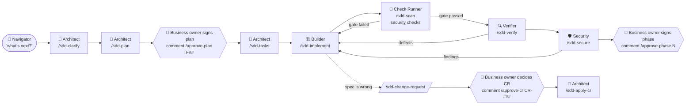

# Which mode do I use? (one-page guide for humans)

**Short answer: you don't have to know.** Stay in the mode Bob opens with — **🧭 SDD Navigator** —
and type what you want ("what's next?", "fix the transfer receipt bug", "change the daily limit").
It tells you which mode owns that and switches you there. If you pick a mode yourself and it's the
wrong one, that mode will say so and offer to switch. Writes in the wrong place are blocked.

IBM Bob V2 has three built-in modes — Agent, Plan and Ask. In Bob IDE all three are overridden in this
repository: Agent becomes the Navigator, and Plan and Ask explain and route; none of them can change files.
(Bob Shell resolves its built-ins first, so there you start in an SDD mode: `bob --mode spec-builder`.)
Every change belongs to one SDD mode and one step. The modes are the same for any industry; what the
product is lives in `sdd/specs/`:

| Mode | Owns | Writes |
|---|---|---|
| 🧭 SDD Navigator | "what's next?", routing | nothing |
| 🎼 SDD Conductor | running the plan, as far as the automation dial allows | nothing (delegates) |
| 📐 Spec Architect | clarify, plan, tasks, change requests | specs, plans, contract, ADRs, design |
| 🏗️ Spec Builder | building, test first; fixing findings | code and tests |
| 🔐 Check Runner | the security checks before testing (`/sdd-scan`) | its triage notes only — never the verdict |
| 🔍 Spec Verifier | proving every acceptance criterion | tests and the verification report |
| 🛡️ Security Reviewer | the hand review (OWASP ASVS L2) | the security report |
| 🔎 SDD PR Reviewer | an advisory review of a branch or pull request (also in the pipeline) | nothing |

## The cycle

Want Bob to drive the whole thing? Switch to **🎼 SDD Conductor** and run `/sdd-prototype`; it
walks this loop and stops at every 👤 box. To see where a feature is and take the next step, use
`/sdd-workflow F04` (the loop is defined in `sdd/workflows/`). Who sits in each 👤 box, and who else takes part in every step (business analyst, architect, developer, AppSec), is in [ROLES.md](ROLES.md).

## I want to…
| …do this | Mode | Type |
|---|---|---|
| Know where we are / what's next | 🧭 SDD Navigator | `what's next?` or `/sdd-next` |
| Let Bob run the plan | 🎼 SDD Conductor | `/sdd-prototype` |
| Discuss or refine a feature spec | 📐 Spec Architect | `/sdd-clarify F04` |
| Get a plan for a feature | 📐 Spec Architect | `/sdd-plan F04` |
| See the whole workflow and the next step | any mode | `/sdd-workflow F04` |
| Approve a plan | **you, on the pull request** | comment `/approve-plan F04` |
| Turn the plan into tasks | 📐 Spec Architect | `/sdd-tasks F04` |
| Build / fix code | 🏗️ Spec Builder | `/sdd-implement F04` (or `F04 T012`) |
| Run the security scan (required before testing) | 🔐 Check Runner | `/sdd-scan F04` (add `--with-bob-review` to include Bob's own findings) |
| Accept a false positive | **AppSec** | a reviewed change to `sdd/governance/checks.json` or an allowlist; with SonarQube, mark it in the SonarQube UI |
| Accept a dependency CVE for now | **AppSec, on the pull request** | comment `/accept-risk CVE-… F04 until 2026-12-31 because …` |
| Check it really works (tests, a11y, E2E) | 🔍 Spec Verifier | `/sdd-verify F04` |
| Security review | 🛡️ Security Reviewer | `/sdd-secure F04` |
| Change something already approved | any mode | `/sdd-change-request short-name` |
| Decide a change request | **you, on the pull request** | comment `/approve-cr CR-001 option A` or `/reject-cr CR-001 <reason>` |
| Approve a phase gate | **you, on the pull request** | comment `/approve-phase 3` |
| Review my branch before I push | 🔎 SDD PR Reviewer | `/sdd-review` |
| Get Bob to fix review findings on GitHub | **developer, on the pull request** | comment `/bob fix F04 <what to change>` |
| Just ask a question | ❓ Ask (or Navigator) | your question |

## What every Bob reply starts with
```
🏗️ Spec Builder · Phase 3 · F04 · step: implement T012 · next: /sdd-verify F04
```
If that line names a different mode than you expected, you're in the wrong place — say "switch".

## Why was my change blocked?
Bob's guard explains it in the reply. The usual reasons:
| Message says | Meaning | Do this |
|---|---|---|
| "No SDD step is active" | Nobody started a step, so nothing may change | Use the step command for what you want (table above) |
| "must run in 🏗️ Spec Builder" | Right step, wrong mode | Switch modes and re-run the command |
| "plan is unapproved / stale" | The plan has no sign-off, or changed after it | Review it, then the business owner comments `/approve-plan F##` |
| "spec.md changed after its plan was approved" | Requirements moved under an approved plan (spec lock) | Raise `/sdd-change-request`; after a human approves it, 📐 `/sdd-apply-cr`, then re-approve the plan |
| "its spec and plan are now locked" | You ran `/sdd-clarify` or `/sdd-plan` on an approved feature | Same: a change request, not a clarify |
| Commit rejected with **G9** | The commit changes approved scope without citing an approved CR | Commit as `spec(CR-###): …` for a CR whose `affects` lists the file |
| "belongs to phase 5; current phase is 3" | Work is ahead of the delivery plan | Finish/approve the current phase, or plan ahead with `/sdd-plan` (one phase ahead max) |
| "governance-protected" | Bob config, guard scripts or approvals | Humans change these via a reviewed PR |
| "has not been scanned yet" / "changed after its last scan" | Testing needs a fresh security scan (Article XI) | 🔐 Check Runner → `/sdd-scan F##` |
| "failed its last external scan" | The quality gate or a High/Critical CVE blocks it | 🏗️ Spec Builder → `/sdd-implement F##` fixes `sdd/reports/scan/F##.md`, then re-scan |
| "Suppressing SonarQube findings … is not allowed" | `NOSONAR` / ignore rules are blocked | Fix it, or a human decides in SonarQube |

## One-time setup (team lead)
1. `git config core.hooksPath sdd/scripts/hooks` (after Phase 0, `pnpm install` does this).
2. GitHub (full guide: [GITHUB.md](GITHUB.md)): put real GitHub logins in `sdd/governance/approvers.json` and teams in `.github/CODEOWNERS`; run `bash sdd/governance/github/setup.sh` to create the `sdd-main` ruleset (PRs only, Code Owner review, required checks **sdd-policy**, **signoffs** and **sonarqube**, no force pushes, merge or rebase but **not squash**, so each task's commit and its requirement tags reach `main` unchanged); add the `SONAR_TOKEN`, `SONAR_HOST_URL` and (for Bob's review and `/bob fix`) `BOB_API_KEY` secrets. Optionally add required reviewers on the **test** environment (for private repositories GitHub offers environment reviewers only on Enterprise). `sdd-gates` runs on every push to every branch too, so a manual commit that breaks the rules is flagged before anyone opens a pull request.
2b. Security checks: nothing to install for the built-in ones; to plug in your own tools see [CHECKS.md](CHECKS.md); to use SonarQube as the scanner follow [SONARQUBE.md](SONARQUBE.md).
3. Optional, org-wide: deploy `sdd/docs/enterprise-policy.sample.json` as a Bob enterprise policy so the hooks can't be removed and every mode switch needs a click.
4. Optional, GitHub Team/Enterprise: import `sdd/docs/github-push-ruleset.sample.json` (Settings → Rules → Rulesets → Import) so only the bypass team (architects, business analysts, business owners, approvers) can push changes to specs, the contract, ADRs, design, approvals and governance files. Set the team's numeric id in `bypass_actors` first (the second bypass actor, integration 15368, is GitHub Actions: it pushes sign-off commits and `/bob fix` commits, which its own checks keep away from these paths). Builders can still push code, `tasks.md` ticks and change requests; planning branches, applied CRs and ADR-0001's resolved versions are pushed by someone on the bypass team.
4. In Bob Settings → Auto-Approve, leave **mode switching** manual so you see every transition.
