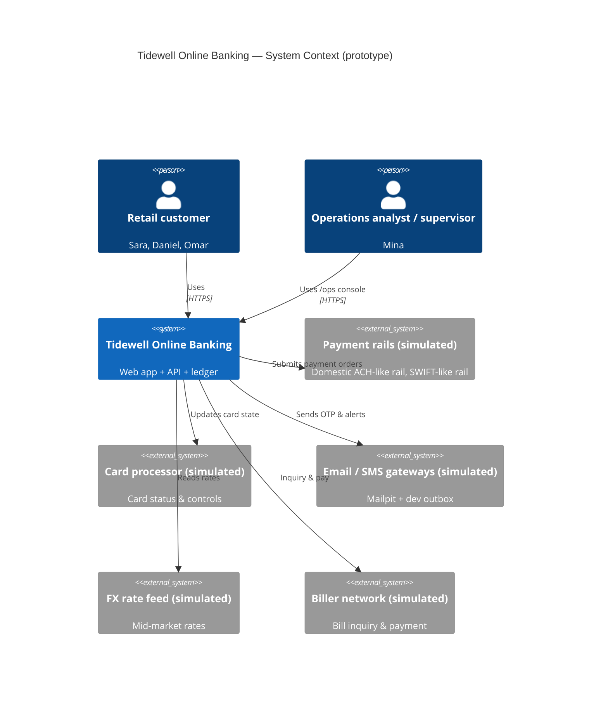
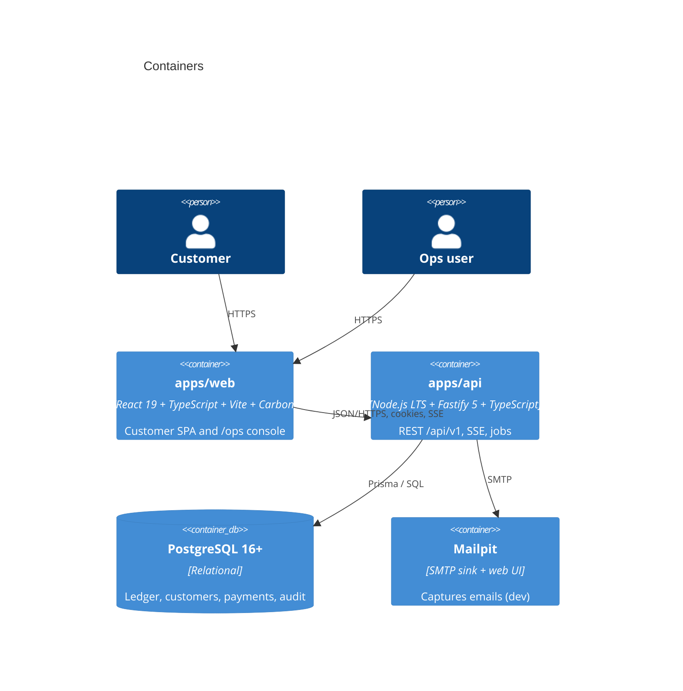
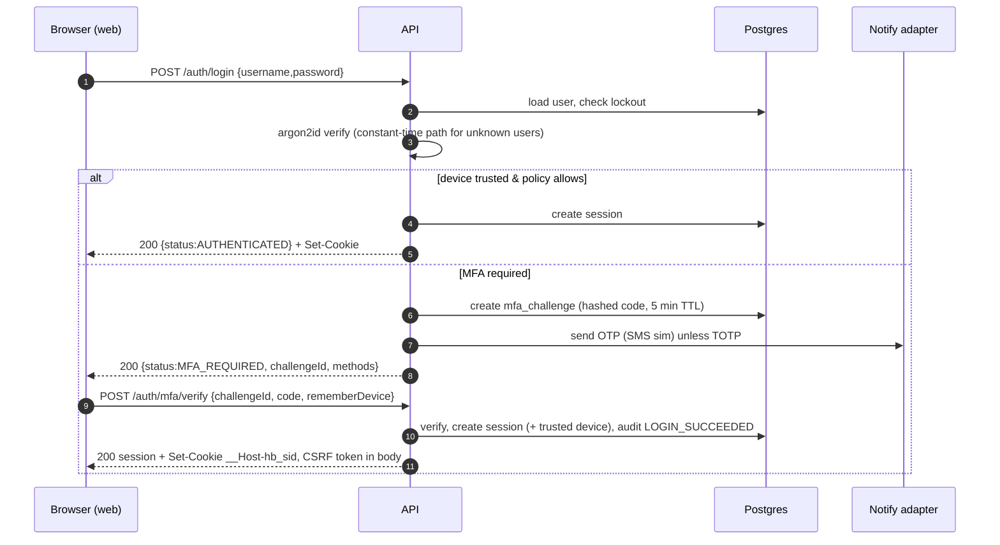
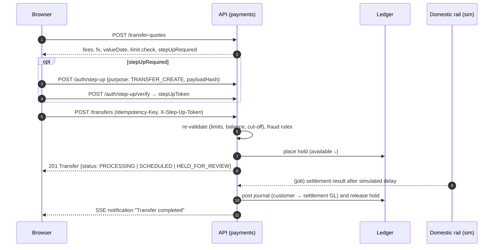

# 02 — System Architecture

## 1. Architectural style
A **modular monolith** API (hexagonal / ports-and-adapters inside each module) plus a
**single-page web app**, in one **TypeScript pnpm monorepo** (ADR-0001). All external
systems are simulated adapters (ADR-0007). PostgreSQL is the system of record.

## 2. C4 — System context


## 3. C4 — Containers


## 4. Technology stack (authoritative)
| Concern | Choice | Notes |
|---|---|---|
| Runtime | Node.js current LTS (≥ 22; 24 recommended) | `.nvmrc` pins exact version |
| Package manager | pnpm workspaces (≥ 9) | `corepack enable` |
| Language | TypeScript (strict, `noUncheckedIndexedAccess`) | ES2022 target |
| API framework | Fastify 5 | `@fastify/helmet`, `@fastify/cookie`, `@fastify/rate-limit`, `@fastify/multipart`, `@fastify/sensible` |
| Validation | Zod + OpenAPI-generated types | Request/response validated against `sdd/contracts/openapi.yaml` |
| ORM / migrations | Prisma (current major) | Raw SQL allowed in ledger repository for `SELECT … FOR UPDATE` |
| Database | PostgreSQL 16+ (Docker) | `SERIALIZABLE` for postings; see SPEC-03 §7 |
| Jobs / scheduler | In-process scheduler (`node-cron`-style) with DB-backed job table + advisory locks | Simulated rails, standing orders, statement generation |
| Passwords | Argon2id (`@node-rs/argon2`) | Params in NFR-SEC |
| TOTP | `otplib` (RFC 6238) | |
| PDF | `pdfkit` (server-side) | Statements, receipts, letters |
| Email | `nodemailer` → Mailpit (SMTP :1025, UI :8025) | |
| Logging | `pino` (JSON) with redaction paths | |
| Web framework | React 19 + Vite | |
| Routing | React Router (data router) | Lazy-loaded route modules |
| Server state | TanStack Query | Query keys per resource |
| Forms | react-hook-form + Zod resolver | Same Zod schemas as API where possible |
| UI | `@carbon/react` (Carbon v11), `@carbon/icons-react`, `@carbon/charts-react` | ADR-0006 |
| i18n | `react-intl` (ICU messages) | `en`, `ar` catalogs; RTL via `dir` attribute |
| Unit / integration tests | Vitest, Supertest-style `fastify.inject` | |
| Contract tests | Response validation against OpenAPI (`openapi-backend` or `ajv` + bundled schema) | |
| E2E / a11y | Playwright + `@axe-core/playwright` | |
| Lint / format | ESLint (typescript-eslint, jsx-a11y, security plugin), Prettier | |
| Contracts codegen | `openapi-typescript` → `packages/contracts` | `pnpm contracts:gen` |

Exact resolved versions are recorded by Bob in `sdd/adr/0001-typescript-monorepo.md` §Resolved versions
during F00.

## 5. Repository layout (target, created in F00)
```
.
├── apps/
│   ├── api/                      # Fastify modular monolith
│   │   ├── src/
│   │   │   ├── main.ts           # bootstrap
│   │   │   ├── app.ts            # buildApp(): plugins, routes, error handler
│   │   │   ├── config/           # env parsing (zod), feature flags
│   │   │   ├── platform/         # cross-cutting: auth, csrf, audit, idempotency, errors, logging, sse, jobs
│   │   │   ├── modules/
│   │   │   │   ├── identity/     # F01, F09 (users, sessions, mfa, devices)
│   │   │   │   ├── customers/    # customer profile, preferences
│   │   │   │   ├── accounts/     # F03 accounts, transactions view
│   │   │   │   ├── ledger/       # SPEC-03 double-entry core (no HTTP routes)
│   │   │   │   ├── payments/     # F04 transfers, beneficiaries, standing orders, limits, fx
│   │   │   │   ├── bills/        # F05
│   │   │   │   ├── cards/        # F06
│   │   │   │   ├── documents/    # F07 statements, letters, receipts (PDF)
│   │   │   │   ├── notifications/# F08 notifications, alert rules, outbox
│   │   │   │   ├── messaging/    # F10
│   │   │   │   ├── ops/          # F11
│   │   │   │   └── dashboard/    # F02 read-model composition
│   │   │   └── adapters/         # simulated rails, card processor, sms, email, fx, billers
│   │   ├── prisma/ (schema.prisma, migrations/, seed.ts)
│   │   └── test/                 # integration tests, factories
│   └── web/
│       ├── src/
│       │   ├── app/              # providers, router, layout shell, error boundaries
│       │   ├── features/         # mirrors API modules: auth, dashboard, accounts, transfers, …
│       │   ├── components/       # shared presentational components (MoneyAmount, StatusTag, …)
│       │   ├── lib/              # api client, query client, formatters, idempotency, session timer
│       │   ├── i18n/             # en.json, ar.json, rtl utilities
│       │   └── styles/           # Carbon theme overrides & tokens (SPEC-05)
│       └── test/                 # component tests
├── packages/
│   ├── sdd/contracts/                # generated OpenAPI types + hand-written Zod schemas
│   ├── domain/                   # PURE TS: Money, Currency, IBAN, BIC, Luhn, business calendar,
│   │                             # state machines, limits engine, fee calculator (no I/O)
│   └── config/                   # shared tsconfig, eslint, prettier, vitest presets
├── e2e/                          # Playwright specs per journey (J1…J12)
├── infra/docker-compose.yml      # postgres, mailpit
├── sdd/contracts/ sdd/specs/ sdd/adr/ sdd/design/ sdd/traceability/ sdd/reports/   # (this spec pack)
└── sdd/scripts/validate-specs.mjs
```

### 5.1 Module boundary rules
1. A module exposes an `index.ts` **public API** (application services + DTOs). Other
   modules import only from that file. Enforced by ESLint `no-restricted-imports`.
2. `packages/domain` has **no** runtime dependencies on Node APIs, Prisma or Fastify.
3. Only `ledger` writes `journal_entries` / `postings`. Other modules call
   `ledger.post(journal)`.
4. Routes are thin: parse → authorize → call application service → map to contract DTO.
5. Adapters implement ports defined in the owning module (`payments/ports/PaymentRail.ts`).

## 6. Cross-cutting concerns (owned by `apps/api/src/platform`)
| Concern | Mechanism | Spec |
|---|---|---|
| Authentication | Server-side session, cookie `__Host-hb_sid` | ADR-0004, F01 |
| CSRF | Synchronizer token: `X-CSRF-Token` header must match session token on unsafe methods | ADR-0004 |
| Authorization | `requireCustomer()`, `requireOpsRole(role)`; repository methods take `customerId` | NFR-SEC |
| Step-up | `requireStepUp(purpose)` checks `X-Step-Up-Token` bound to purpose + payload hash | F01 |
| Idempotency | `idempotent()` preHandler; table `idempotency_records` | ADR-0005 |
| Errors | RFC 9457 problem+json; error catalog in `sdd/contracts/error-codes.md` | SPEC-04 |
| Audit | `audit.record(event)` in the same DB transaction as the change | NFR-OBS, SPEC-03 |
| Logging | pino, `traceId` per request (`traceparent` honoured), redaction list | NFR-OBS |
| Rate limiting | per-IP and per-user buckets | NFR-SEC |
| Real-time | SSE endpoint `/api/v1/notifications/stream` | F08 |
| Jobs | `jobs` table + advisory lock; runner every 5 s in dev | §8 |
| Clock | Injectable `Clock` port; `DEMO_MODE` allows `/dev/clock` offset | SPEC-91 |

## 7. Key runtime flows

### 7.1 Sign-in with MFA


### 7.2 Transfer to a domestic beneficiary


## 8. Background jobs
| Job | Schedule (dev) | Purpose |
|---|---|---|
| `rail.domestic.settle` | every 5 s | Settle PROCESSING domestic orders older than 5 s |
| `rail.swift.settle` | every 10 s | Settle international orders older than 30 s |
| `standing-orders.run` | every minute | Create transfers for due standing orders (business-day aware) |
| `scheduled-transfers.release` | every minute | Move SCHEDULED → PROCESSING on execution date after 00:05 local |
| `statements.generate` | 02:00 local, 1st of month | Generate previous-month statements |
| `holds.expire` | hourly | Expire stale card authorisation holds (7 days) |
| `sessions.purge` | hourly | Delete expired sessions & challenges |
| `idempotency.purge` | hourly | Delete records older than 24 h |

`POST /dev/jobs/run {job}` triggers any job immediately in `DEMO_MODE`.

## 9. Environments and configuration
| Variable | Example | Required | Notes |
|---|---|---|---|
| `NODE_ENV` | development | yes | |
| `DEMO_MODE` | true | yes | Must default to `false` if unset |
| `DATABASE_URL` | postgresql://hb:hb@localhost:5432/tidewell | yes | |
| `SESSION_SECRET` | 64+ random chars | yes | Rotatable (array) |
| `DATA_ENCRYPTION_KEY` | base64 32 bytes | yes | AES-256-GCM for PAN vault & TOTP secrets |
| `SESSION_IDLE_MINUTES` | 5 | no | Default 5 |
| `SESSION_ABSOLUTE_HOURS` | 8 | no | Default 8 |
| `SMTP_URL` | smtp://localhost:1025 | yes | Mailpit |
| `WEB_ORIGIN` | http://localhost:5173 | yes | CORS + CSP |
| `API_PORT` | 4000 | no | |
| `LOG_LEVEL` | info | no | |

`.env.example` is committed; `.env` is git-ignored. Config is parsed once with Zod and the
process fails fast on invalid configuration.

### Ports (dev)
web `5173` · api `4000` (Vite proxies `/api` → `4000`) · postgres `5432` · mailpit `8025`/`1025`

## 10. Future production considerations (documented, not built)
HSM/KMS-managed keys; WAF and bot protection; Redis-backed sessions & rate limits;
outbox + message broker (Kafka) for events; read replicas for history; OpenShift
deployment with Helm; SIEM integration of audit stream; real ISO 20022 (pacs.008)
messaging; card tokenisation via processor; PSD2/open-banking style consent APIs.
