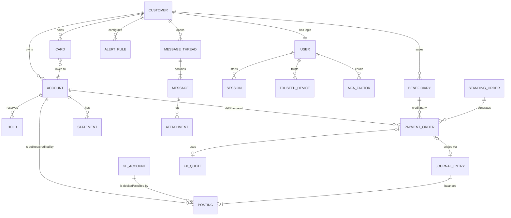
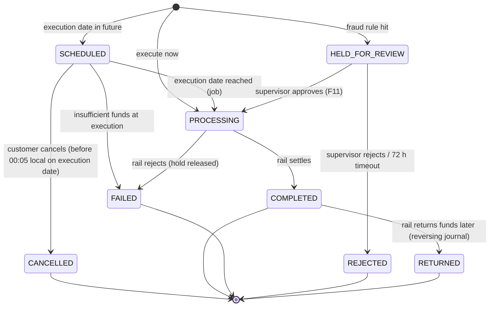
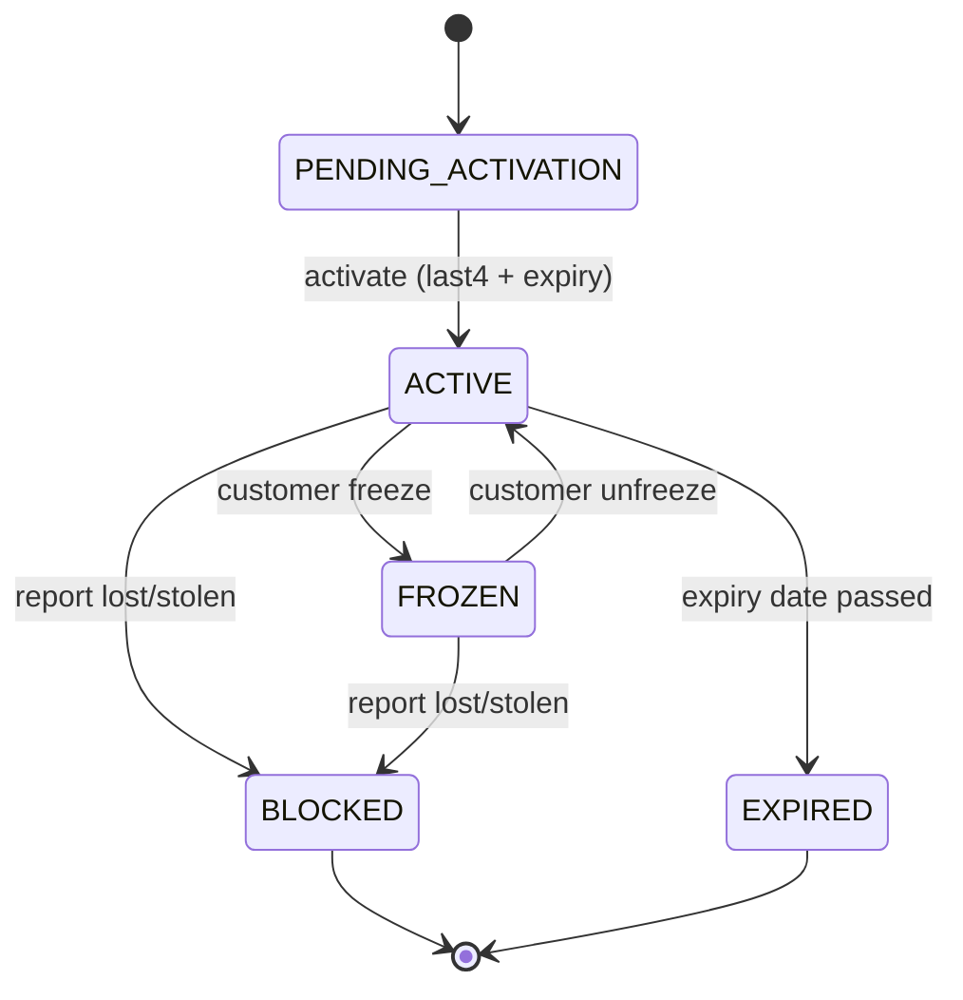

# 03 — Domain Model, Ledger and State Machines

## 1. Bounded contexts
| Context | Aggregates | Owner module |
|---|---|---|
| Identity | User, Credential, Session, TrustedDevice, MfaFactor, Challenge, RecoveryCode | `identity` |
| Customer | Customer, Address, Preferences, Consent | `customers` |
| Accounts & Ledger | Account, GlAccount, JournalEntry, Posting, Hold | `accounts`, `ledger` |
| Payments | Beneficiary, PaymentOrder, StandingOrder, FxQuote, LimitProfile, LimitUsage | `payments` |
| Bills | Biller, SavedBiller, BillPayment | `bills` |
| Cards | Card, CardControls, CardVaultEntry | `cards` |
| Documents | Statement, GeneratedDocument | `documents` |
| Notifications | Notification, AlertRule, OutboxMessage | `notifications` |
| Messaging | MessageThread, Message, Attachment | `messaging` |
| Operations | OpsUser (role on User), HeldPaymentReview, AccessJustification | `ops` |
| Platform | AuditEvent, IdempotencyRecord, Job | `platform` |

## 2. Identifiers
- All public IDs are **opaque, prefixed ULIDs**: `cus_`, `usr_`, `acc_`, `txn_`, `jrn_`,
  `pst_`, `hld_`, `ben_`, `pay_`, `sto_`, `fxq_`, `bil_`, `sbl_`, `bpy_`, `crd_`, `stm_`,
  `doc_`, `ntf_`, `alr_`, `thr_`, `msg_`, `att_`, `aud_`, `dev_`, `ses_`, `chl_`.
- IDs are never sequential, never derived from PII, and never accepted as proof of
  ownership (authorization is always checked).
- Customer-facing **references** (shown on receipts) are human-friendly:
  `HB` + business date `YYMMDD` + 6 base32 chars, e.g. `HB261118-7KQ2MX`.

## 3. Entity–relationship overview

## 4. Money and currency
### 4.1 Representation
- Domain type `Money { minor: bigint; currency: CurrencyCode }` in `packages/domain`.
- Wire format: `{ "amount": "<decimal string>", "currency": "AED" }` where the string has
  **exactly** the currency exponent digits after the point (`"12.00"` AED, `"0.500"` KWD, `"5"` JPY).
- DB columns: `amount_minor BIGINT NOT NULL`, `currency CHAR(3) NOT NULL`.
- Parsing rejects: more decimals than exponent, exponent notation, signs on amounts that
  must be positive, values > 999,999,999,999 minor units for customer input.

### 4.2 Supported currencies
| Code | Exponent | Customer accounts | FX tradable | Notes |
|---|---|---|---|---|
| AED | 2 | ✔ | ✔ | Base currency |
| USD | 2 | ✔ | ✔ | |
| EUR | 2 | ✔ | ✔ | |
| GBP | 2 | — | ✔ | International transfers only |
| KWD | 3 | — | ✔ | Exercises 3-dp path |
| SAR | 2 | — | ✔ | |
| BHD | 3 | — | ✔ | Exercises 3-dp path |
| JPY | 0 | — | ✔ | Exercises 0-dp path in tests |

### 4.3 FX
- Mid rates come from the simulated FX adapter (seeded, SPEC-91 §5), refreshed every 60 s
  with ±0.05 % jitter in demo mode.
- Customer rate = mid × (1 ∓ margin). Default margin **0.50 %** (bank sells foreign at
  mid × 1.005 AED per unit, buys at mid × 0.995).
- An `FxQuote` locks a rate for **30 seconds**; executing after expiry → `FX_QUOTE_EXPIRED`.
- Conversion rounds the **credited** amount half-even to the target exponent when the quote is
  created; the quote stores both amounts and the sub-minor `roundingResidue`. Postings use the
  stored amounts, so each currency balances by construction. Allocation residues (one conversion
  split across several legs) are posted to `GL-FX-ROUNDING-<CCY>`.
- Cross rates (USD→EUR) go via AED and are quoted as a single customer rate.

## 5. Ledger (ADR-0003)
### 5.1 Chart of accounts (GL)
| GL code | Type | Purpose |
|---|---|---|
| `GL-SETTLE-DOMESTIC-AED` | Asset (clearing) | Outgoing/incoming domestic rail |
| `GL-SETTLE-SWIFT-<CCY>` | Asset (nostro) | International rail per currency |
| `GL-FX-POSITION-<CCY>` | Position | FX conversions per currency |
| `GL-FX-ROUNDING-<CCY>` | Income/Expense | Rounding residue |
| `GL-FEE-INCOME-AED` | Income | Transfer and service fees |
| `GL-BILLER-SETTLE-AED` | Liability | Biller payouts |
| `GL-CARD-SETTLE-<CCY>` | Clearing | Card scheme settlement (seed history) |
| `GL-INTEREST-EXPENSE-<CCY>` | Expense | Savings interest (seed history) |
| `GL-SEED-EQUITY-<CCY>` | Equity | Opening balances created by seed only |

### 5.2 Postings
- `JournalEntry { id, businessDate, valueDate, type, reference, description, createdAt, createdBy }`
- `Posting { id, journalId, accountRef (customer acc_ or GL code), direction: DEBIT|CREDIT, amountMinor > 0, currency }`
- Customer account sign convention (customer view): CREDIT increases a deposit account balance;
  DEBIT decreases it. For CREDIT_CARD accounts the **balance owed** increases with DEBIT.
- A customer-visible **Transaction** is a read model derived from postings on a customer
  account plus enrichment (merchant, category, counterparty, channel, FX details).

### 5.3 Ledger invariants (enforced in code AND verified by `pnpm ledger:check`)
| ID | Invariant |
|---|---|
| LGR-INV-1 | For every journal entry and every currency: Σ DEBIT = Σ CREDIT. |
| LGR-INV-2 | Postings are append-only. Corrections are reversing journals referencing the original. |
| LGR-INV-3 | Account ledger balance = Σ postings (cached balance must equal recomputed balance). |
| LGR-INV-4 | Available balance = ledger balance − Σ active holds + overdraft limit; must be ≥ 0 after any customer-initiated debit. |
| LGR-INV-5 | A posting's currency equals its account's currency. |
| LGR-INV-6 | No posting on CLOSED accounts; no customer debits on FROZEN or DORMANT accounts. |
| LGR-INV-7 | A hold is released exactly once (by settlement, failure, cancellation or expiry). |
| LGR-INV-8 | Every journal created by a customer action references an idempotency key and an audit event. |

### 5.4 Concurrency
- Debiting service runs in a DB transaction: `SELECT … FROM accounts WHERE id = $1 FOR UPDATE`,
  recompute available, insert hold/postings, update cached balance, insert audit, commit.
- Isolation `READ COMMITTED` + row lock is sufficient for single-account debit; multi-account
  operations lock accounts **in ascending id order** to avoid deadlocks.
- Test: 50 concurrent transfers of 1,000.00 from an account holding 10,000.00 → exactly 10
  succeed, 40 fail `INSUFFICIENT_FUNDS`, balance = 0.00 (see SPEC-90 §5).

### 5.5 Posting recipes
| Event | Debit | Credit |
|---|---|---|
| Own transfer same ccy | source acc | target acc |
| Own transfer FX (AED→USD) | source acc (AED); `GL-FX-POSITION-USD` (USD) | `GL-FX-POSITION-AED` (AED); target acc (USD) |
| Internal (Tidewell) beneficiary | source acc | beneficiary's Tidewell acc |
| Domestic outgoing settled | source acc | `GL-SETTLE-DOMESTIC-AED` |
| International outgoing (SHA, fee 35.00) | source acc (amount + fee) | `GL-SETTLE-SWIFT-<CCY>` (via FX legs if needed); `GL-FEE-INCOME-AED` (fee) |
| Bill payment | source acc | `GL-BILLER-SETTLE-AED` |
| Rail rejection after settlement | reversing journal of the above | |
| Card purchase (seed) | customer acc | `GL-CARD-SETTLE-<CCY>` |
| Credit card repayment | source deposit acc | credit-card acc (reduces owed) |

## 6. State machines

### 6.1 PaymentOrder (transfers and bill payments)

- Holds are placed on entering `PROCESSING` or `HELD_FOR_REVIEW`; `SCHEDULED` orders place no
  hold until execution (balance re-checked then).
- Own-account and internal transfers go `PROCESSING → COMPLETED` synchronously in the same request.
- Every transition writes `payment_order_events (orderId, from, to, reason, at, actor)`.

### 6.2 Card

### 6.3 User (credential status)
`PENDING_ENROLMENT → ACTIVE ⇄ TEMP_LOCKED (15 min, auto) ; ACTIVE/TEMP_LOCKED → LOCKED (ops unlock required) ; ACTIVE → DISABLED (ops)`

### 6.4 Account
`ACTIVE ⇄ FROZEN (ops) ; ACTIVE → DORMANT (seed only) ; ACTIVE → CLOSED (seed only)`

### 6.5 Message thread
`OPEN → AWAITING_CUSTOMER ⇄ OPEN → CLOSED (customer or ops) ; CLOSED → OPEN (customer reopens within 14 days)`

## 7. Core entity attributes (abridged; Prisma schema must include at least these)
| Entity | Key attributes |
|---|---|
| Customer | id, customerNumber (8 digits), fullName, preferredName, dateOfBirth, nationalIdMasked, email, mobileE164, addresses[], segment (RETAIL/PREMIER), createdAt |
| User | id, customerId?, username (unique, case-insensitive), passwordHash, status, failedLoginCount, lockedUntil, roles (CUSTOMER, OPS_AGENT, OPS_SUPERVISOR), lastLoginAt |
| Session | id (hashed), userId, createdAt, lastSeenAt, absoluteExpiresAt, ip, userAgent, deviceId?, csrfToken, mfaLevel (NONE/MFA) |
| TrustedDevice | id, userId, name, fingerprintHash, createdAt, lastSeenAt, revokedAt |
| MfaFactor | id, userId, type (TOTP/SMS), secretEncrypted?, phoneMasked?, verifiedAt |
| Challenge | id, userId, purpose (LOGIN/ENROL/RESET/STEP_UP/CONTACT_CHANGE), codeHash, payloadHash?, attempts, expiresAt, consumedAt |
| Account | id, customerId, type, productName, nickname, currency, iban, accountNumber, status, overdraftLimitMinor, interestRateBps, openedAt, ledgerBalanceMinor (cache), version |
| Hold | id, accountId, amountMinor, reason (PAYMENT/CARD_AUTH), referenceId, status (ACTIVE/RELEASED/EXPIRED), expiresAt |
| Beneficiary | id, customerId, type, displayName, nickname, accountHolderName, iban?, accountNumber?, bic?, bankName, bankCountry, currency?, address?, copResult, createdAt, coolingOffUntil, isFavourite, status |
| PaymentOrder | id, reference, customerId, kind (OWN/INTERNAL/DOMESTIC/INTERNATIONAL/BILL), debitAccountId, beneficiaryId?, creditAccountId?, amount, debitAmount, fee, fxQuoteId?, chargeBearer (OUR/SHA/BEN)?, purposeCode?, customerReference, executionDate, valueDate, status, failureCode?, standingOrderId?, idempotencyKey, createdAt |
| StandingOrder | id, customerId, template (PaymentOrder fields), frequency (WEEKLY/MONTHLY/QUARTERLY), startDate, endDate?, nextRunDate, remainingRuns?, status |
| LimitProfile | customerId, dailyExternalLimitMinor (AED), perTransactionMaxMinor, newBeneficiaryDailyLimitMinor, customerChosenDailyLimitMinor |
| Card | id, customerId, accountId, kind (DEBIT/CREDIT), network (VISA/MASTERCARD), last4, expiryMonth, expiryYear, cardholderName, status, controls{ecommerce, international, contactless, atm}, limits{atmDaily, posDaily, onlineDaily}, replacedById? |
| Statement | id, accountId, periodStart, periodEnd, openingBalance, closingBalance, totalCredits, totalDebits, generatedAt, storageKey |
| Notification | id, customerId, type, severity, titleKey, bodyParams, deepLink, readAt, createdAt |
| AlertRule | id, customerId, type, enabled, thresholdMinor?, currency?, channels[], mandatory |
| AuditEvent | id, occurredAt, actorType (CUSTOMER/OPS/SYSTEM), actorId, action, targetType, targetId, outcome, ip, userAgent, traceId, metadata (redacted JSON), hashPrev, hash |

Audit events form a **hash chain** (`hash = sha256(hashPrev || canonicalJson(event))`) so
tampering is detectable by `pnpm audit:verify`.

## 8. Domain events (internal, in-process)
Listed in `sdd/contracts/domain-events.md`. Notifications (F08) subscribe to these events;
modules never call the notifications module directly.
