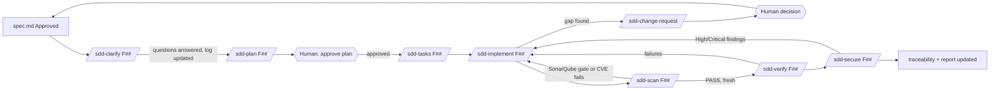

# 92 — Delivery Plan and Phase Gates

This file is the **execution order** for Bob. The `/sdd-prototype` command and the
🎼 SDD Conductor mode walk through it phase by phase. A phase starts only when the previous
gate is approved by a human (Constitution Art. IX).

## 1. Per-feature loop (applies inside every phase)

| Step | Mode | Output |
|---|---|---|
| Clarify | 📐 Spec Architect | Clarifications log rows in `spec.md` (no behaviour change without CR) |
| Plan | 📐 Spec Architect | `sdd/specs/features/F##/plan.md` (template) incl. Constitution check |
| Tasks | 📐 Spec Architect | `sdd/specs/features/F##/tasks.md` with T-IDs, Req refs, DoD |
| Implement | 🏗️ Spec Builder | Code + tests, one commit per task |
| **Scan** | 🔐 Check Runner | `sdd/reports/scan/F##.json` + `.md` from SonarQube (+ SCA, optional Bob SARIF) — **required before testing** (Article XI) |
| Verify | 🔍 Spec Verifier | `sdd/reports/verification/F##.md`, updated `sdd/traceability/matrix.md` |
| Secure | 🛡️ Security Reviewer | `sdd/reports/security/F##.md` |

**Promotion rule.** "Promotion to testing" means `/sdd-verify` locally and the `test` environment
in CI. Both require a passing external scan of the exact code being promoted: the step guard checks
`sdd/reports/scan/F##.json` against the current code fingerprint; `sdd-gates / sonarqube` gates the
merge; `promote-to-test` re-scans `main` and confirms the gate for that commit before `deploy-test`.
A feature is *done* only while its scan evidence is still fresh, so every phase gate implies a
current PASS for every feature in the phase.

## 2. Phases
### Phase 0 — Foundation
- **Features:** F00 (plan & tasks are provided — a human reviews and approves the plan with
  `approve.mjs plan F00`; then skip straight to Implement).
- **Demo at gate:** shell in en/ar, light/dark, demo banner, dev outbox, `pnpm verify` output.
- **Gate checklist:**
  - [ ] `pnpm verify` green from clean clone (FND-001-AC1 timing recorded)
  - [ ] Scanner chosen in `sdd/governance/checks.json` (built-in checks; or SonarQube set up per `sdd/docs/SONARQUBE.md`); the bank's own tools switched on where wanted (`sdd/docs/CHECKS.md`); `sdd/reports/scan/F00.md` PASS
  - [ ] All FND requirements covered in matrix
  - [ ] ADR-0001 resolved versions filled
  - [ ] `sdd/reports/verification/F00.md` written
  - [ ] Human approval recorded below

### Phase 1 — Identity
- **Features:** F01 (all P1; P2 items AUTH-004/005/012 may slip to Phase 4).
- **Journeys:** J1, J2 (sign-in part).
- **Gate checklist:**
  - [ ] Verification + security reports for F01; no open High/Critical
  - [ ] Lockout, timeout modal, cross-tab sign-out demoed
  - [ ] AuthZ/CSRF matrix tests in place (they will grow with each feature)
  - [ ] Human approval

### Phase 2 — Accounts & Dashboard
- **Features:** F03 (P1, P2), F02 (P1; DASH-008/011/013 P2 may follow in Phase 4).
- **Journeys:** J2 complete.
- **Gate checklist:**
  - [ ] NFR-PERF-002 EXPLAIN tests pass on seed volume
  - [ ] Ledger check after seed; statement-ready data present
  - [ ] a11y sweep on dashboard/accounts in both locales
  - [ ] Human approval

### Phase 3 — Money movement (core)
- **Features:** F04 P1 requirements (own, FX own, internal, domestic, beneficiaries, scheduled, history, receipt, failures).
- **Journeys:** J3, J4.
- **Gate checklist:**
  - [ ] Concurrency + idempotency storms green 20× (NFR-REL-002/003)
  - [ ] Step-up binding matrix green
  - [ ] Receipts PDF reviewed by PO
  - [ ] Security review focusing on payments (checklist §Payments) — no High/Critical
  - [ ] SonarQube: every hotspot in `apps/api/src/modules/payments` and `ledger` reviewed by a human
  - [ ] Human approval

### Phase 4 — Profile, security settings, notifications
- **Features:** F09 (all), F08 (all), slipped P2 items from F01/F02.
- **Journeys:** J9, J10.
- **Gate checklist:**
  - [ ] Mandatory alerts locked; SSE replay test
  - [ ] ATO review (contact change + password + device) — no High/Critical
  - [ ] Human approval

### Phase 5 — Everyday banking breadth
- **Features:** F04 P2 (international, standing orders, limits, repeat), F05, F06, F07.
- **Journeys:** J5, J6, J7, J8.
- **Gate checklist:**
  - [ ] Statement reconciliation property test green
  - [ ] Card reveal leak tests green; PAN vault encryption verified
  - [ ] Biller/FX/card-processor fault toggles demoed (NFR-REL-005)
  - [ ] Human approval

### Phase 6 — Service & operations (P3, stretch)
- **Features:** F10, F11.
- **Journeys:** J11, J12.
- **Gate checklist:**
  - [ ] Role matrix + maker-checker tests green
  - [ ] Attachment security tests green
  - [ ] Human approval

### Phase 7 — Hardening & demo readiness
- **Scope:** NFR verification sweep (perf scripts, Lighthouse, full a11y incl. manual SR smoke,
  dependency/secret scans), polish backlog (S3 defects), demo script rehearsal.
- **Gate checklist:**
  - [ ] All NFRs verified or waived with PO signature in `sdd/reports/verification/NFR.md`
  - [ ] `sdd/traceability/matrix.md`: 0 uncovered P1/P2
  - [ ] `sdd/reports/security/final.md`: 0 open High/Critical
  - [ ] SonarQube on `main`: 0 open vulnerabilities on overall code, 100 % hotspots reviewed; SCA: 0 unwaived High/Critical; every waiver re-reviewed
  - [ ] Demo script (`sdd/design/user-flows.md` §5) executed end-to-end without intervention
  - [ ] Human approval → prototype release tag `v1.0.0-prototype`

## 3. Gate approvals
The loop and its gates are defined as workflows in `sdd/workflows/` (feature-delivery, change-request,
phase-gate). The **machine record** is `sdd/state/approvals.json`, written only from a person's sign-off: by
default a comment on the phase pull request — `/approve-phase <n>` (plans: `/approve-plan F##`; change
requests: `/approve-cr CR-### option A` or `/reject-cr`; dependency-CVE waivers by AppSec:
`/accept-risk <ID> F## until <date> because …`, ≤ 90 days) — recorded by the sign-off workflow after checking
`sdd/governance/approvers.json`, and re-verified against the comment by the `signoffs` check. Where the
repository takes terminal sign-offs, the same decisions are `node sdd/scripts/approve.mjs phase <n>` etc.
Plan approvals are bound to the SHA-256 of the plan **and** of the feature's `spec.md`, so editing
either voids the approval (spec lock, Article I.4). Re-approving after a spec change needs a change
request approved since the previous approval, or an explicit, recorded `--override "<reason>"`. Bob reads the current phase from that file (via the
`[SDD STATE]` hook) and cannot write it. The table below is an optional human-readable log.

| Phase | Date | Approver | Decision | Notes |
|---|---|---|---|---|
| 0 | | | | |
| 1 | | | | |
| 2 | | | | |
| 3 | | | | |
| 4 | | | | |
| 5 | | | | |
| 6 | | | | |
| 7 | | | | |

## 4. Branching & commits
- Branch per phase: `phase/<n>-<slug>`, with a **draft pull request into `main` from the start**: it collects
  the phase's commits and every sign-off comment, runs the checks (`sdd-policy`, `signoffs`, `sonarqube`) on
  each push and gets Bob's advisory review once it is ready. A person pushes and opens it (Bob's
  `/create-pull-request` fills in the template); Bob never pushes, merges or signs. Merge after the phase
  sign-off, with a merge commit (no squash).
- Conventional Commits with task and requirement refs: `feat(F04): T012 limits engine [XFER-021]`.
- Tags: `phase-<n>-approved` after each gate.

## 5. Autonomy guidance for Bob
| Situation | Bob may proceed autonomously? |
|---|---|
| Implementing a task whose DoD is clear | Yes |
| Choosing a library not in SPEC-02 §4 | No — propose in plan with justification |
| Spec ambiguity that changes behaviour | No — `/sdd-change-request` |
| Spec ambiguity that is purely presentational (spacing, icon choice within Carbon) | Yes — note in commit |
| Failing test unrelated to current task | Fix if trivial (< 15 min) else log defect and continue |
| Lowering a threshold / skipping a test | Never |
| Editing constitution, NFR, ADR decision, contract (in Builder mode) | Never (mode-enforced) |
| Writing any file without an active step | Never (hook-enforced) |
| Approving a plan, phase or change request | Never (human-only: sign-off comments are refused from bots, the hook blocks `approve.mjs`, the GitHub scripts and any sign-off command Bob might post, and `signoffs` re-verifies each record) |
| Reviewing a pull request (advisory) | Yes — 🔎 SDD PR Reviewer runs headless on GitHub; findings only |
| Pushing fixes to a pull request | Only when a developer comments `/bob fix F## …`; inside that feature's implement step, re-checked before the workflow pushes |
| Changing an approved spec, a foundation spec, an NFR or the contract outside planning | Never directly — only `/sdd-apply-cr` for a human-approved CR (step guard + git rule G9) |
| Running the external scan when a feature's tasks are done | Yes — `/sdd-scan F##` in 🔐 Check Runner |
| Fixing SonarQube findings or upgrading a vulnerable dependency | Yes — as `T0NN-fix` tasks in 🏗️ Spec Builder |
| Marking a SonarQube issue/hotspot safe, waiving a CVE, adding `NOSONAR`, changing the scan scope or gate | Never (human-only; read-only MCP, hook, git rule G8, CODEOWNERS) |

## 6. How the cycle is enforced
| Layer | Mechanism | Stops |
|---|---|---|
| 1 Front door | Built-in Agent/Plan/Ask overridden as read-only routers (`.bob/custom_modes.yaml`) | Work starting in the "wrong" mode |
| 2 Context | `UserPromptSubmit` hook injects `[SDD STATE]` into every prompt | Modes losing track of phase/step |
| 3 Who | Per-mode `fileRegex` edit permissions | e.g. Builder editing specs |
| 4 When | `step.mjs` preconditions + `PreToolUse` hook write scope per active step | e.g. coding before plan approval, verifying with open tasks |
| 5 Humans | Hash-bound sign-offs from people: pull-request comments checked against `sdd/governance/approvers.json` on the default branch (or interactive `approve.mjs`); a plan sign-off also locks the feature's `spec.md` | Bob self-approving; requirements changing after sign-off |
| 6 External verdict | SonarQube quality gate + SCA via `scan.mjs`, evidence bound to a code fingerprint; read-only SonarQube MCP; `NOSONAR`/scope/evidence writes denied | Untested code reaching testing, Bob grading its own work, hiding findings |
| 7 Backstop | `commit-msg` hook (G1–G9) + `sdd-gates` CI on every push and pull request (`sdd-policy`, `signoffs` — each sign-off re-verified against its GitHub comment — and `sonarqube`) + `promote-to-test` (re-checks what reached `main`) + CODEOWNERS + the `sdd-main` ruleset + optional GitHub push rules; Bob's advisory review on every ready pull request | Manual edits, other tools, `--no-verify`, hand-written sign-offs, spec edits without a CR, deploying unscanned commits |
| 8 Org | Bob enterprise policy `EnforcedHooks`, `DisabledAutoApprovalGroups` (`sdd/docs/enterprise-policy.sample.json`) | Users removing hooks or auto-approving mode switches |
