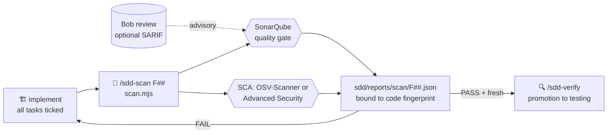

# NFR — Security

> Requirement format: EARS. Verification column tells the Spec Verifier which test layer
> proves it. Security review mode re-checks every item at each phase gate.

## 1. Authentication & credentials

#### NFR-SEC-001 — Password storage
- **Priority:** P1 · **Type:** Ubiquitous
- **EARS:** THE SYSTEM SHALL store passwords only as Argon2id hashes with memory ≥ 19 MiB, iterations ≥ 2, parallelism 1, and a per-hash random salt.
- **Acceptance criteria:**
  - **NFR-SEC-001-AC1** Given a newly set password, when the users table is inspected, then the stored value starts with `$argon2id$` and contains `m=19456` (or higher), `t=2` (or higher).
  - **NFR-SEC-001-AC2** Given any log output during registration and login, then the password never appears.
- **Verification:** integration test + log-capture test

#### NFR-SEC-002 — Password policy
- **Priority:** P1 · **Type:** Ubiquitous
- **EARS:** THE SYSTEM SHALL accept passwords of 12–128 characters (any Unicode, spaces allowed), SHALL reject passwords found in the bundled breached/common-password list (top 100k), SHALL reject passwords containing the username or customer number, and SHALL NOT impose composition rules or periodic expiry.
- **Acceptance criteria:**
  - **NFR-SEC-002-AC1** Given password `Password1234`, when set, then `422 PASSWORD_TOO_COMMON`.
  - **NFR-SEC-002-AC2** Given an 11-character password, then `422 PASSWORD_TOO_SHORT`.
  - **NFR-SEC-002-AC3** Given a 20-character passphrase with spaces and Arabic letters, then it is accepted.
- **Verification:** unit (domain password policy) + E2E strength meter

#### NFR-SEC-003 — Credential stuffing & brute force resistance
- **Priority:** P1 · **Type:** Event-driven
- **EARS:** WHEN 5 consecutive failed sign-ins occur for a username, THE SYSTEM SHALL temporarily lock it for 15 minutes; WHEN 10 failures occur within 24 h, THE SYSTEM SHALL set it to LOCKED requiring operations unlock; and THE SYSTEM SHALL return identical responses and similar timing for unknown usernames and wrong passwords.
- **Acceptance criteria:**
  - **NFR-SEC-003-AC1** Given 5 wrong passwords, when the 6th attempt uses the right password within 15 min, then `423 ACCOUNT_TEMPORARILY_LOCKED`.
  - **NFR-SEC-003-AC2** Given an unknown username, then the response body and status equal the wrong-password case and the median response time differs by < 50 ms over 20 samples.
- **Verification:** integration test

#### NFR-SEC-004 — Session security
- **Priority:** P1 · **Type:** Ubiquitous
- **EARS:** THE SYSTEM SHALL use server-side sessions identified by ≥ 128-bit random IDs stored only as SHA-256 hashes, rotate the session ID on login and privilege change, expire sessions after `SESSION_IDLE_MINUTES` (default 5) idle and `SESSION_ABSOLUTE_HOURS` (default 8) absolute, and set cookies `HttpOnly; Secure; SameSite=Strict; Path=/` with the `__Host-` prefix outside local dev.
- **Acceptance criteria:**
  - **NFR-SEC-004-AC1** Given a session idle for 5 min 1 s, when any API is called, then `401 SESSION_EXPIRED`.
  - **NFR-SEC-004-AC2** Given login, then the pre-login session ID (if any) is invalid afterwards.
  - **NFR-SEC-004-AC3** Given logout, then the session row is deleted and the cookie is cleared with `Max-Age=0`.
- **Verification:** integration test (fake clock)

#### NFR-SEC-005 — CSRF protection
- **Priority:** P1 · **Type:** Unwanted behaviour
- **EARS:** IF an unsafe HTTP method is received without a valid `X-CSRF-Token` matching the session, THEN THE SYSTEM SHALL reject it with `403 CSRF_TOKEN_INVALID` and perform no side effect.
- **Acceptance criteria:**
  - **NFR-SEC-005-AC1** Given a valid session and no CSRF header, when `POST /transfers`, then 403 and no payment order row exists.
- **Verification:** integration test across all unsafe routes (route-table driven)

## 2. Authorization

#### NFR-SEC-010 — Object-level authorization (anti-IDOR)
- **Priority:** P1 · **Type:** Unwanted behaviour
- **EARS:** IF a customer requests or mutates a resource that does not belong to them, THEN THE SYSTEM SHALL respond `404 NOT_FOUND` and record an `AUTHZ_DENIED` audit event.
- **Acceptance criteria:**
  - **NFR-SEC-010-AC1** Given Sara's session and Daniel's account ID, when `GET /accounts/{danielAccountId}`, then 404.
  - **NFR-SEC-010-AC2** An automated "authorization matrix" test iterates every route with a path ID and asserts cross-customer access yields 404.
- **Verification:** integration (matrix test generated from OpenAPI paths)

#### NFR-SEC-011 — Role-based access for operations
- **Priority:** P3 · **Type:** Ubiquitous
- **EARS:** THE SYSTEM SHALL restrict `/api/v1/ops/**` to users with role OPS_AGENT or OPS_SUPERVISOR as specified per operation, and SHALL prevent customers from holding ops roles.
- **Acceptance criteria:**
  - **NFR-SEC-011-AC1** Given a customer session, when calling any `/ops` route, then `403 FORBIDDEN`.
- **Verification:** integration

#### NFR-SEC-012 — Mass assignment protection
- **Priority:** P1 · **Type:** Unwanted behaviour
- **EARS:** IF a request body contains properties not defined in the contract schema, THEN THE SYSTEM SHALL reject the request with `400 VALIDATION_FAILED`.
- **Acceptance criteria:**
  - **NFR-SEC-012-AC1** Given `PATCH /accounts/{id}` with `{"nickname":"x","status":"CLOSED"}`, then 400 and status unchanged.
- **Verification:** integration (schemas use `additionalProperties: false`)

## 3. Input, output and transport

#### NFR-SEC-020 — Input validation
- **Priority:** P1 · **Type:** Ubiquitous
- **EARS:** THE SYSTEM SHALL validate every request (path, query, headers, body) against the OpenAPI contract with explicit lengths, patterns and enums before reaching application services.
- **Acceptance criteria:**
  - **NFR-SEC-020-AC1** Given a 10,000-character `customerReference`, then `400 VALIDATION_FAILED` with field error.
- **Verification:** contract + integration

#### NFR-SEC-021 — Injection prevention
- **Priority:** P1 · **Type:** Ubiquitous
- **EARS:** THE SYSTEM SHALL use parameterised queries exclusively, SHALL NOT build SQL from string concatenation, and SHALL encode all output rendered in the web app (React default escaping; `dangerouslySetInnerHTML` forbidden by lint).
- **Acceptance criteria:**
  - **NFR-SEC-021-AC1** Search `q=' OR 1=1 --` returns 200 with zero unintended results.
  - **NFR-SEC-021-AC2** A beneficiary nickname `` renders as text.
- **Verification:** integration + E2E + lint rule

#### NFR-SEC-022 — Security headers and CSP
- **Priority:** P1 · **Type:** Ubiquitous
- **EARS:** THE SYSTEM SHALL send the headers listed in SPEC-04 §11, including a CSP with `default-src 'self'`, no `unsafe-inline` scripts, `object-src 'none'`, `frame-ancestors 'none'`, and `connect-src 'self'`.
- **Acceptance criteria:**
  - **NFR-SEC-022-AC1** E2E asserts headers on `/` and `/api/v1/health/live`.
  - **NFR-SEC-022-AC2** No CSP violations reported in browser console during the full E2E suite.
- **Verification:** E2E

#### NFR-SEC-023 — Rate limiting
- **Priority:** P1 · **Type:** Event-driven
- **EARS:** WHEN a client exceeds a bucket defined in SPEC-04 §8, THE SYSTEM SHALL respond `429 RATE_LIMITED` with `Retry-After`.
- **Acceptance criteria:**
  - **NFR-SEC-023-AC1** 11 login attempts from one IP within a minute → 11th gets 429.
- **Verification:** integration

#### NFR-SEC-024 — File upload safety
- **Priority:** P3 · **Type:** Unwanted behaviour
- **EARS:** IF an uploaded file exceeds 5 MB, is not PDF/PNG/JPEG by magic-byte detection, or matches the EICAR test signature, THEN THE SYSTEM SHALL reject it and not persist its bytes.
- **Acceptance criteria:**
  - **NFR-SEC-024-AC1** A `.pdf`-named PE executable is rejected `422 ATTACHMENT_TYPE_NOT_ALLOWED`.
  - **NFR-SEC-024-AC2** EICAR string upload → `422 ATTACHMENT_MALWARE_DETECTED`.
- **Verification:** integration

## 4. Sensitive data

#### NFR-SEC-030 — Encryption of sensitive fields at rest
- **Priority:** P2 · **Type:** Ubiquitous
- **EARS:** THE SYSTEM SHALL encrypt full PAN, CVC seed and TOTP secrets with AES-256-GCM using `DATA_ENCRYPTION_KEY`, with a unique 96-bit nonce per value and a key-version prefix enabling rotation.
- **Acceptance criteria:**
  - **NFR-SEC-030-AC1** Querying `card_vault` shows ciphertext only; decrypt works with current key; re-encrypt script migrates to a new key version.
- **Verification:** unit + integration

#### NFR-SEC-031 — Log redaction
- **Priority:** P1 · **Type:** Ubiquitous
- **EARS:** THE SYSTEM SHALL redact from logs and error responses: passwords, OTP codes, session IDs, CSRF tokens, step-up tokens, `Authorization`/`Cookie` headers, full PAN, CVC, IBAN (except last 4), email and phone (masked), national ID.
- **Acceptance criteria:**
  - **NFR-SEC-031-AC1** A log-capture test runs the J1–J4 integration flows and asserts none of the seeded secrets/PII literal values appear in captured logs.
- **Verification:** integration (log capture)

#### NFR-SEC-032 — Secrets management
- **Priority:** P1 · **Type:** Ubiquitous
- **EARS:** THE SYSTEM SHALL read secrets only from environment variables validated at start-up and SHALL refuse to start in non-dev mode with default/example secret values.
- **Acceptance criteria:**
  - **NFR-SEC-032-AC1** `NODE_ENV=production` with `SESSION_SECRET=change-me` → process exits non-zero with a clear message.
  - **NFR-SEC-032-AC2** `gitleaks`-style scan (`pnpm security:secrets`) finds no secrets in the repo.
- **Verification:** unit + CI script

#### NFR-SEC-033 — Demo-only capabilities are fenced
- **Priority:** P1 · **Type:** State-driven
- **EARS:** WHILE `DEMO_MODE` is not `true`, THE SYSTEM SHALL NOT register `/dev/**` routes, SHALL NOT accept the demo OTP bypass, and SHALL NOT honour demo markers (`DEMO-REJECT`, `DEMO-RETURN`, `DEMO-REVIEW`) or other magic test values.
- **Acceptance criteria:**
  - **NFR-SEC-033-AC1** With `DEMO_MODE=false`, `GET /api/v1/dev/outbox` → 404 and OTP `000000` is rejected.
- **Verification:** integration (both modes)

## 5. Supply chain & code

#### NFR-SEC-040 — Dependency hygiene
- **Priority:** P2 · **Type:** Ubiquitous
- **EARS:** THE SYSTEM SHALL have no known High/Critical vulnerabilities in production dependencies per `pnpm audit --prod` at each phase gate, and SHALL commit `pnpm-lock.yaml`.
- **Acceptance criteria:**
  - **NFR-SEC-040-AC1** `pnpm security:deps` exits 0 or every finding has a dated waiver in `sdd/reports/security/waivers.md`.
- **Verification:** CI script

#### NFR-SEC-041 — Static analysis
- **Priority:** P2 · **Type:** Ubiquitous
- **EARS:** THE SYSTEM SHALL pass ESLint with `eslint-plugin-security`, `no-restricted-syntax` bans on `eval`, `new Function`, `dangerouslySetInnerHTML`, and float-money patterns (`parseFloat`, `toFixed` in money modules).
- **Acceptance criteria:**
  - **NFR-SEC-041-AC1** `pnpm lint` exits 0 with zero warnings in `packages/domain` and `apps/api/src/modules/ledger`.
- **Verification:** CI
- **Note:** Lint and the built-in checks are the fast in-loop checks; the authoritative verdict is the security scan before testing (NFR-SEC-042/043).

## 5a. External security scan before testing (Constitution Article XI, ADR-0009)

> The pipeline below is part of the delivery system, not of the banking app: these requirements are
> proven by the governance scripts (`sdd/scripts/scan.mjs`, `lib.mjs`, `git-check.mjs`), the CI
> workflows and tests under `tools/governance/` (F00 task T031).

#### NFR-SEC-042 — External scan gates promotion to testing
- **Priority:** P1 · **Type:** Event-driven
- **EARS:** WHEN all tasks of a feature are complete, THE SYSTEM SHALL require a security scan of the current production code by the scanner set in `sdd/governance/checks.json` (the configured checks, or SonarQube), run through `sdd/scripts/scan.mjs`, and SHALL refuse to start verification or security review of that feature until the resulting evidence in `sdd/reports/scan/F##.json` is PASS for the current code fingerprint.
- **Acceptance criteria:**
  - **NFR-SEC-042-AC1** Given F03 with every task ticked and no `sdd/reports/scan/F03.json`, when `step.mjs start verify F03 --mode spec-verifier` runs, then it exits 1 and names 🔐 Check Runner → `/sdd-scan F03`.
  - **NFR-SEC-042-AC2** Given PASS evidence for F03, when any file under `apps/`, `packages/`, `infra/` or a root manifest changes, then the evidence is reported as stale and verification is refused until a re-scan; changes to test files alone do not invalidate it.
  - **NFR-SEC-042-AC3** Given a pull request to `main`, when the `sdd-gates / sonarqube` job runs `scan.mjs --ci` and the quality gate fails, then the job fails and branch protection blocks the merge.
  - **NFR-SEC-042-AC4** Given a push to `main`, when `promote-to-test` runs, then `deploy-test` starts only after `scan.mjs --gate-only --revision <sha>` confirms a passing gate for that exact commit.
- **Verification:** governance tests (`tools/governance/scan-gate.test.ts`) + CI run

#### NFR-SEC-043 — Tidewell Bank quality gate
- **Priority:** P1 · **Type:** Ubiquitous
- **EARS:** WHERE the scanner is SonarQube, THE SYSTEM SHALL be analysed against the SonarQube quality gate named by `SONAR_QUALITY_GATE`, which SHALL fail when, on new code, any vulnerability is open, any security hotspot is unreviewed, or the security rating is worse than A, and when, on overall code, any vulnerability of High/Blocker impact is open; THE SYSTEM SHALL fail a scan whose project is attached to any other gate.
- **Acceptance criteria:**
  - **NFR-SEC-043-AC1** Given a new string-built SQL query in `apps/api`, when scanned, then the gate is ERROR, the result is FAIL and `sdd/reports/scan/F##.md` lists the issue with its rule and location.
  - **NFR-SEC-043-AC2** Given a new security hotspot (e.g. cookie without `Secure`) not yet reviewed, when scanned, then the result is FAIL.
  - **NFR-SEC-043-AC3** Given the project is switched to SonarQube's default gate, when scanned, then the result is FAIL with reason "project uses quality gate … expected Tidewell Bank".
- **Verification:** gate definition in `sdd/docs/SONARQUBE.md` §3 + seeded-vulnerability rehearsal on a throwaway branch (never merged)

#### NFR-SEC-044 — Dependency vulnerabilities (CVEs) block testing
- **Priority:** P1 · **Type:** Unwanted behaviour
- **EARS:** IF a production or development dependency has a known vulnerability with CVSS ≥ 7.0 or no rating, as reported by the `SCA_PROVIDER`, THEN THE SYSTEM SHALL fail the scan unless an unexpired human waiver recorded with `approve.mjs waiver` covers that vulnerability ID or one of its aliases.
- **Acceptance criteria:**
  - **NFR-SEC-044-AC1** Given `SCA_PROVIDER=osv-scanner` and a lockfile pinning a package version with a CVSS 9.8 advisory, when scanned, then FAIL, and the report lists the advisory, its CVE alias, the package and the fixed version.
  - **NFR-SEC-044-AC2** Given a waiver for that CVE expiring in the future, when scanned, then the finding is shown as waived (approver, expiry) and does not fail the scan; after the expiry date it fails again.
  - **NFR-SEC-044-AC3** Given `SCA_PROVIDER=sonar`, when scanned, then dependency risks are judged by the quality gate's dependency-risk conditions (SonarQube Advanced Security) and OSV-Scanner is not run.
  - **NFR-SEC-044-AC4** Waivers can only be recorded interactively by a human; `approve.mjs waiver` refuses an expiry more than 90 days ahead or a reason shorter than 15 characters.
- **Verification:** governance tests with a fake SCA output + CI run

#### NFR-SEC-045 — Bob findings are advisory and portable
- **Priority:** P2 · **Type:** Optional feature
- **EARS:** WHERE `BOB_REVIEW_IN_SCAN` is `on` or `/sdd-scan` runs with `--with-bob-review`, THE SYSTEM SHALL import Bob's security review from `sdd/reports/scan/F##.bob.sarif` (SARIF 2.1.0) into SonarQube as external issues of the engine "IBM Bob (advisory review)", SHALL drop results without a valid repository code location, and SHALL list any CVE or GHSA ID Bob claims as a lead that is confirmed only when the SCA provider reports the same ID.
- **Acceptance criteria:**
  - **NFR-SEC-045-AC1** Given a Bob SARIF result at `apps/api/src/modules/accounts/accounts.repository.ts:42`, when scanned with `--with-bob-review`, then the SonarQube analysis contains one external issue from "IBM Bob (advisory review)" at that location.
  - **NFR-SEC-045-AC2** Given a Bob result claiming `CVE-2099-0001` that the SCA provider does not report, then it is not imported, appears under "CVE leads" as "not counted", and does not affect the result.
  - **NFR-SEC-045-AC3** Given `--with-bob-review` but no `sdd/reports/scan/F##.bob.sarif`, then `scan.mjs` exits 2 and writes no evidence.
- **Verification:** governance tests with fixture SARIF

#### NFR-SEC-046 — Scan integrity
- **Priority:** P1 · **Type:** Unwanted behaviour
- **EARS:** IF anyone attempts to hand-write scan evidence, narrow the analysis scope, silence findings in code, run the scanner outside `scan.mjs`, or change SonarQube issue or hotspot status from Bob, THEN THE SYSTEM SHALL refuse the action and SHALL treat evidence not produced by `scan.mjs` as missing.
- **Acceptance criteria:**
  - **NFR-SEC-046-AC1** Given any active step, when Bob writes `sdd/reports/scan/F03.json` or `sonar-project.properties`, then the PreToolUse guard denies it; `check-runner` mode may only edit `sdd/reports/scan/F##.md` and `sdd/reports/scan/F##.bob.sarif`.
  - **NFR-SEC-046-AC2** Given a commit adding `// NOSONAR` under `apps/`, then the commit-msg hook and the CI policy job reject it (rule G8); the PreToolUse guard denies the edit in Bob.
  - **NFR-SEC-046-AC3** Given Bob runs `npx @sonar/scan` directly or `scan.mjs` with `-Dsonar.*`, then the command is denied.
  - **NFR-SEC-046-AC4** `.bob/mcp.json` configures the SonarQube MCP server with `SONARQUBE_READ_ONLY=true` and token values that reference environment variables; `validate-specs.mjs` fails otherwise, and SonarQube MCP status-changing tools are denied by the hook.
  - **NFR-SEC-046-AC5** Given evidence whose `codeFingerprint` does not match, or whose `producer` is not `sdd/scripts/scan.mjs`, then the feature state is `scan-stale` or `scan-evidence-invalid` and verification is refused.
- **Verification:** governance tests (`tools/governance/`) + validator

## 6. Fraud & abuse controls (simulated)

#### NFR-SEC-050 — Fraud rule engine (simulated)
- **Priority:** P2 · **Type:** Event-driven
- **EARS:** WHEN a payment order is created, THE SYSTEM SHALL evaluate fraud rules (FR-1 amount ≥ 30,000.00 AED-eq to a beneficiary added < 72 h ago; FR-2 > 5 external payments within 10 min; FR-3 first international payment > 10,000.00 AED-eq; FR-4 demo-only marker `DEMO-REVIEW` in the customer reference) and SHALL place matching orders in `HELD_FOR_REVIEW` with the rule IDs recorded.
- **Acceptance criteria:**
  - **NFR-SEC-050-AC1** Given a new beneficiary (1 h old) and amount 30,000.00, then status HELD_FOR_REVIEW, rule `FR-1`, customer sees "Under review" with explanation copy.
- **Verification:** unit (rules) + integration

#### NFR-SEC-051 — Security notifications are mandatory
- **Priority:** P2 · **Type:** Event-driven
- **EARS:** WHEN a password changes, MFA changes, a new device signs in, contact details change, or a beneficiary is added, THE SYSTEM SHALL notify the customer in-app and via email/SMS regardless of alert preferences.
- **Acceptance criteria:**
  - **NFR-SEC-051-AC1** Alert preferences UI shows these as locked "Always on" toggles.
- **Verification:** integration + E2E
